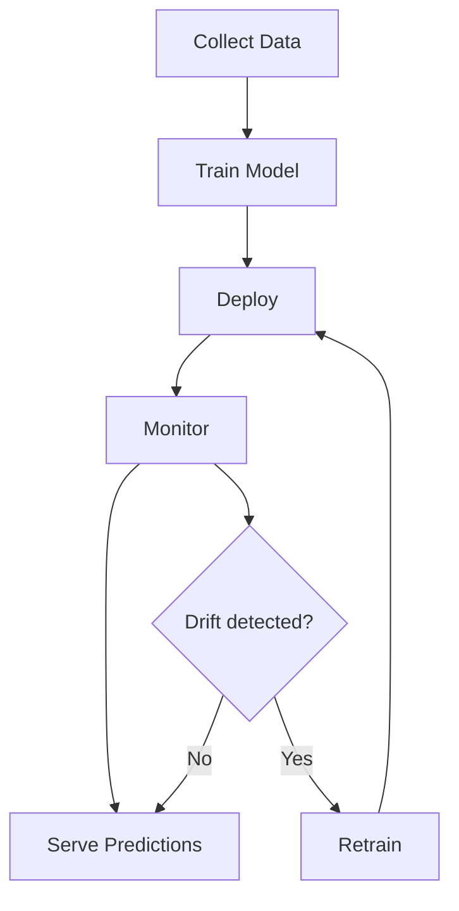

import TawkWidget from '../../../../components/TawkWidget.astro';
import UniversalContentContributors from '../../../../components/UniversalContentContributors.astro';
import InArticleAd from '../../../../components/InArticleAd.astro';
import Copyright from '../../../../components/Copyright.astro';
import BionicText from '../../../../components/BionicText.astro';
import TailwindWrapper from '../../../../components/TailwindWrapper.jsx';
import { Tabs, TabItem } from '@astrojs/starlight/components';
import { Card, CardGrid, Badge, Steps, LinkButton, FileTree } from '@astrojs/starlight/components';

<UniversalContentContributors 
  contributors={frontmatter.contributors}
/>


import MlAiFundamentalsComments from '../../../../components/ml-ai-fundamentals/MlAiFundamentalsComments.astro';

A model that scores well on your computer does nothing for the plant until its answers reach someone who can act on them. And from its first day of work, the machine and the seasons go on changing while the model stays as it was trained. This lesson shows three ways to put a trained model to work: a program that runs on a schedule, a small web service, and plain C code inside a microcontroller. Then it shows how to notice that a model no longer matches its machine, and what a model must never be trusted with. #MLDeployment #ModelServing #MLOps

## The ML Lifecycle

To **deploy** a model is to put it where it receives new readings and its answers are used. Training is one step of a loop:



A deployed model is fixed. It knows the machine as it was in the training readings. **Drift** is what happens next: the readings or the machine change, and the model's examples no longer describe it. So a model in use needs a regular check against fresh readings.

### Advice from the model, limits in the device

The answer of a model is an estimate, and it is sometimes wrong. Use it as advice for a person or for a slow decision: inspect this pump this week, order a bearing.

Do not put a model in the path that protects people or equipment. The limit that stops a motor at once on high temperature or high current stays a plain fixed rule in the controller. A fixed rule can be read and tested, and it does not depend on a network or on training readings.

## Step 1: Train and Save the Model

<InArticleAd />


The model sorts each reading of four sensors into three classes: healthy, degraded or critical. The program saves it with `joblib`, a library that writes a Python object to a file. It also saves the mean and the standard deviation of each sensor in the training set, to compare with new readings later.

```python
import numpy as np
import pandas as pd
import joblib
from sklearn.ensemble import GradientBoostingClassifier
from sklearn.preprocessing import StandardScaler
from sklearn.pipeline import Pipeline
from sklearn.model_selection import train_test_split
from sklearn.metrics import classification_report

np.random.seed(42)

# Generate sensor data for equipment health classification
n_samples = 20000
vibration = np.random.normal(2.0, 0.5, n_samples)
temperature = np.random.normal(50, 8, n_samples)
pressure = np.random.normal(5.0, 0.8, n_samples)
current_draw = np.random.normal(3.5, 0.6, n_samples)

# Labels: 0=healthy, 1=degraded, 2=critical
labels = np.zeros(n_samples, dtype=int)

# Degraded: elevated vibration AND elevated temperature
degraded_mask = (vibration > 2.5) & (temperature > 55)
labels[degraded_mask] = 1

# Critical: high vibration AND high temperature AND low pressure
critical_mask = (vibration > 3.0) & (temperature > 58) & (pressure < 4.5)
labels[critical_mask] = 2

X = np.column_stack([vibration, temperature, pressure, current_draw])
feature_names = ['vibration_g', 'temperature_c', 'pressure_bar', 'current_a']

X_train, X_test, y_train, y_test = train_test_split(
    X, labels, test_size=0.2, random_state=42, stratify=labels
)

# Build pipeline
pipe = Pipeline([
    ('scaler', StandardScaler()),
    ('model', GradientBoostingClassifier(
        n_estimators=100, max_depth=4, random_state=42
    )),
])

pipe.fit(X_train, y_train)
y_pred = pipe.predict(X_test)

print("Model Performance on Test Set:")
print(classification_report(y_test, y_pred,
      target_names=['Healthy', 'Degraded', 'Critical']))

# Save the pipeline
joblib.dump(pipe, 'equipment_health_model.joblib')
joblib.dump(feature_names, 'feature_names.joblib')

# Also save training data statistics for drift detection later
train_stats = {
    'means': X_train.mean(axis=0).tolist(),
    'stds': X_train.std(axis=0).tolist(),
    'mins': X_train.min(axis=0).tolist(),
    'maxs': X_train.max(axis=0).tolist(),
}
joblib.dump(train_stats, 'training_stats.joblib')

print("\nSaved: equipment_health_model.joblib")
print("Saved: feature_names.joblib")
print("Saved: training_stats.joblib")
print(f"\nTraining data statistics:")
for i, name in enumerate(feature_names):
    print(f"  {name}: mean={train_stats['means'][i]:.3f}, "
          f"std={train_stats['stds'][i]:.3f}")
```

**Expected output (approximate):**

```text
Model Performance on Test Set:
              precision    recall  f1-score   support

     Healthy       1.00      1.00      1.00      3818
    Degraded       1.00      1.00      1.00       178
    Critical       1.00      1.00      1.00         4

    accuracy                           1.00      4000
   macro avg       1.00      1.00      1.00      4000
weighted avg       1.00      1.00      1.00      4000

Saved: equipment_health_model.joblib
Saved: feature_names.joblib
Saved: training_stats.joblib

Training data statistics:
  vibration_g: mean=2.003, std=0.500
  temperature_c: mean=49.891, std=8.016
  pressure_bar: mean=5.001, std=0.806
  current_a: mean=3.498, std=0.598
```

The scores are perfect because the labels in this practice data come from exact threshold rules with no noise. Real equipment never behaves like this. Notice also how rare the critical class is: 4 of the 4,000 test readings. A report on 4 readings says very little.

## Option 1: Batch Inference Script

<InArticleAd />


Using a trained model on new readings is called **inference**. The simplest way is in batches: on a schedule, a program loads the model, reads the new readings, and writes one answer for each.

```python
import numpy as np
import joblib

np.random.seed(42)

# Load the saved model
pipe = joblib.load('equipment_health_model.joblib')
feature_names = joblib.load('feature_names.joblib')

# Simulate incoming batch of sensor readings
batch_data = np.array([
    [1.8, 48.0, 5.2, 3.4],   # probably healthy
    [2.7, 56.5, 4.8, 3.9],   # elevated readings
    [3.2, 60.1, 4.2, 4.5],   # high vibration, high temp, low pressure
    [2.1, 52.0, 5.1, 3.3],   # probably healthy
    [2.9, 57.8, 4.3, 4.1],   # borderline
])

labels = ['Healthy', 'Degraded', 'Critical']

predictions = pipe.predict(batch_data)
probabilities = pipe.predict_proba(batch_data)

print("Batch Inference Results")
print("=" * 65)
print(f"{'Vibration':>10} {'Temp':>6} {'Press':>6} {'Current':>8} | "
      f"{'Prediction':>10} {'Confidence':>10}")
print("-" * 65)

for i in range(len(batch_data)):
    pred_label = labels[predictions[i]]
    confidence = probabilities[i][predictions[i]]
    print(f"{batch_data[i][0]:10.1f} {batch_data[i][1]:6.1f} "
          f"{batch_data[i][2]:6.1f} {batch_data[i][3]:8.1f} | "
          f"{pred_label:>10} {confidence:>9.1%}")
```

**Expected output:**

```text
Batch Inference Results
=================================================================
 Vibration   Temp  Press  Current | Prediction Confidence
-----------------------------------------------------------------
       1.8   48.0    5.2      3.4 |    Healthy    100.0%
       2.7   56.5    4.8      3.9 |   Degraded    100.0%
       3.2   60.1    4.2      4.5 |   Critical    100.0%
       2.1   52.0    5.1      3.3 |    Healthy    100.0%
       2.9   57.8    4.3      4.1 |   Degraded    100.0%
```

A batch program is enough when answers are needed every hour or every day, as for planning maintenance.

"Confidence" is the model's own estimate of how sure it is. On a reading unlike anything in the training set, a model can be confident and wrong.

## Option 2: Flask REST API

<InArticleAd />


To answer one reading at a time, make the model a small web service that waits for requests over HTTP, the protocol of web pages. A device sends its reading as JSON, a text format of names and values, and receives the answer in the same format. Such a service is a REST API, and Flask is a Python library for writing one. A microcontroller with WiFi, a small computer at the machine or a web page can use it.

The answer travels over a network, which can be slow or down: one more reason to keep the protecting limit in the device.

<Card title="In real use: check what the request contains" icon="warning">
The simple `required` / `missing` check below is enough for a demonstration. In real use, check every field with a validation library, so that a bad request gets a clear error (HTTP status 400) and does not stop the service. A common choice is **Pydantic**:

```python
from pydantic import BaseModel, Field, ValidationError

class SensorReading(BaseModel):
    vibration_g: float = Field(ge=0, le=20)
    temperature_c: float = Field(ge=-40, le=150)
    pressure_bar: float = Field(ge=0, le=20)
    current_a:   float = Field(ge=0, le=100)

@app.route('/predict', methods=['POST'])
def predict():
    try:
        reading = SensorReading(**request.get_json())
    except ValidationError as e:
        return jsonify({'error': e.errors()}), 400
    # reading is now typed and bounds-checked
    ...
```

Pydantic (or `flask-pydantic`, `FastAPI`, `marshmallow`) finds missing fields, wrong types and values out of range with one line for each field.
</Card>

```python
"""
equipment_api.py

Run with: python equipment_api.py
Test with: curl or the test script below
Requires: pip install flask
"""
import numpy as np
import joblib
from flask import Flask, request, jsonify

app = Flask(__name__)

# Load model at startup (once, not per-request)
pipe = joblib.load('equipment_health_model.joblib')
labels = ['healthy', 'degraded', 'critical']

@app.route('/predict', methods=['POST'])
def predict():
    data = request.get_json()

    # Validate input
    required = ['vibration_g', 'temperature_c', 'pressure_bar', 'current_a']
    missing = [f for f in required if f not in data]
    if missing:
        return jsonify({'error': f'Missing fields: {missing}'}), 400

    # Build feature array
    features = np.array([[
        data['vibration_g'],
        data['temperature_c'],
        data['pressure_bar'],
        data['current_a'],
    ]])

    # Predict
    prediction = pipe.predict(features)[0]
    probabilities = pipe.predict_proba(features)[0]

    return jsonify({
        'status': labels[prediction],
        'confidence': round(float(probabilities[prediction]), 4),
        'probabilities': {
            labels[i]: round(float(p), 4)
            for i, p in enumerate(probabilities)
        }
    })

@app.route('/health', methods=['GET'])
def health():
    return jsonify({'status': 'ok', 'model': 'equipment_health_v1'})

if __name__ == '__main__':
    print("Starting Equipment Health API on http://localhost:5000")
    print("POST /predict with JSON: {vibration_g, temperature_c, pressure_bar, current_a}")
    print("GET  /health for API status")
    app.run(host='0.0.0.0', port=5000, debug=False)
```

### Testing the API

Once the server is running, test it from another terminal or script:

```python
"""
test_api.py

Requires: pip install requests
Run the server first: python equipment_api.py
Then run this: python test_api.py
"""
import requests
import json

url = 'http://localhost:5000/predict'

# Test cases
test_readings = [
    {'vibration_g': 1.8, 'temperature_c': 48.0,
     'pressure_bar': 5.2, 'current_a': 3.4},
    {'vibration_g': 3.2, 'temperature_c': 60.1,
     'pressure_bar': 4.2, 'current_a': 4.5},
]

for reading in test_readings:
    response = requests.post(url, json=reading)
    result = response.json()
    print(f"Input: vib={reading['vibration_g']}, "
          f"temp={reading['temperature_c']}, "
          f"press={reading['pressure_bar']}")
    print(f"  Status: {result['status']} "
          f"(confidence: {result['confidence']:.1%})")
    print(f"  Probabilities: {result['probabilities']}")
    print()
```

**Expected output:**

```text
Input: vib=1.8, temp=48.0, press=5.2
  Status: healthy (confidence: 100.0%)
  Probabilities: {'critical': 0.0, 'degraded': 0.0, 'healthy': 1.0}

Input: vib=3.2, temp=60.1, press=4.2
  Status: critical (confidence: 100.0%)
  Probabilities: {'critical': 1.0, 'degraded': 0.0, 'healthy': 0.0}
```

You can also test with curl:

```bash
curl -X POST http://localhost:5000/predict \
  -H "Content-Type: application/json" \
  -d '{"vibration_g": 2.7, "temperature_c": 56.5, "pressure_bar": 4.8, "current_a": 3.9}'
```

## Option 3: Export to C Arrays for MCU Deployment

<InArticleAd />


A microcontroller (MCU), the small computer on a chip inside a device, cannot run Python. But a decision tree is only a list of comparisons, so it can be written out as C code: arrays of numbers for the scaling, and nested `if` and `else` lines for the questions. The device then answers by itself, with no network. The program trains a small tree on the same data and writes that C file.

```python
import numpy as np
import joblib

np.random.seed(42)

# For MCU deployment, we train a simple decision tree
# (easier to convert than gradient boosting)
from sklearn.tree import DecisionTreeClassifier
from sklearn.preprocessing import StandardScaler
from sklearn.pipeline import Pipeline

# Regenerate training data
n_samples = 20000
vibration = np.random.normal(2.0, 0.5, n_samples)
temperature = np.random.normal(50, 8, n_samples)
pressure = np.random.normal(5.0, 0.8, n_samples)
current_draw = np.random.normal(3.5, 0.6, n_samples)

labels = np.zeros(n_samples, dtype=int)
labels[(vibration > 2.5) & (temperature > 55)] = 1
labels[(vibration > 3.0) & (temperature > 58) & (pressure < 4.5)] = 2

X = np.column_stack([vibration, temperature, pressure, current_draw])

scaler = StandardScaler()
X_scaled = scaler.fit_transform(X)

tree = DecisionTreeClassifier(max_depth=6, random_state=42)
tree.fit(X_scaled, labels)

# Export scaler parameters and tree structure as C code
def export_scaler_to_c(scaler, feature_names):
    lines = []
    lines.append("// Auto-generated scaler parameters")
    lines.append(f"#define N_FEATURES {len(feature_names)}")
    lines.append("")

    means = scaler.mean_
    scales = scaler.scale_

    lines.append("const float scaler_mean[N_FEATURES] = {")
    lines.append("    " + ", ".join(f"{m:.6f}f" for m in means))
    lines.append("};")
    lines.append("")
    lines.append("const float scaler_scale[N_FEATURES] = {")
    lines.append("    " + ", ".join(f"{s:.6f}f" for s in scales))
    lines.append("};")
    lines.append("")
    lines.append("void scale_features(const float* raw, float* scaled) {")
    lines.append("    for (int i = 0; i < N_FEATURES; i++) {")
    lines.append("        scaled[i] = (raw[i] - scaler_mean[i]) / scaler_scale[i];")
    lines.append("    }")
    lines.append("}")
    return "\n".join(lines)

def export_tree_to_c(tree, class_names):
    """Convert a decision tree to nested if/else C code."""
    tree_ = tree.tree_
    feature_names_c = ['vibration_g', 'temperature_c', 'pressure_bar', 'current_a']

    lines = []
    lines.append("// Auto-generated decision tree")
    lines.append(f"// Max depth: {tree.get_depth()}, Leaves: {tree.get_n_leaves()}")
    lines.append("")
    lines.append("const char* class_names[] = {" +
                 ", ".join(f'"{c}"' for c in class_names) + "};")
    lines.append("")
    lines.append("int predict(const float* features) {")

    def recurse(node, depth):
        indent = "    " * (depth + 1)
        if tree_.feature[node] != -2:  # not a leaf
            feat = feature_names_c[tree_.feature[node]]
            threshold = tree_.threshold[node]
            lines.append(f"{indent}if (features[{tree_.feature[node]}] <= {threshold:.6f}f) {{")
            recurse(tree_.children_left[node], depth + 1)
            lines.append(f"{indent}}} else {{")
            recurse(tree_.children_right[node], depth + 1)
            lines.append(f"{indent}}}")
        else:
            class_idx = np.argmax(tree_.value[node])
            lines.append(f"{indent}return {class_idx};  // {class_names[class_idx]}")

    recurse(0, 0)
    lines.append("}")
    return "\n".join(lines)

scaler_c = export_scaler_to_c(scaler, ['vibration_g', 'temperature_c', 'pressure_bar', 'current_a'])
tree_c = export_tree_to_c(tree, ['healthy', 'degraded', 'critical'])

header_content = f"""#ifndef EQUIPMENT_MODEL_H
#define EQUIPMENT_MODEL_H

{scaler_c}

{tree_c}

#endif // EQUIPMENT_MODEL_H
"""

# Write to file
with open('equipment_model.h', 'w') as f:
    f.write(header_content)

print("Generated: equipment_model.h")
print(f"Tree depth: {tree.get_depth()}")
print(f"Tree leaves: {tree.get_n_leaves()}")
print(f"File size: {len(header_content)} bytes")
print("\nThis header can be included directly in Arduino/ESP-IDF/STM32 firmware.")
print("No Python, no ML library needed. Just basic float arithmetic.")
```

**Expected output:**

```text
Generated: equipment_model.h
Tree depth: 6
Tree leaves: 9
File size: 1760 bytes

This header can be included directly in Arduino/ESP-IDF/STM32 firmware.
No Python, no ML library needed. Just basic float arithmetic.
```

The firmware calls `scale_features()` on the raw readings and then `predict()`, which returns the number of the class.

Inside the device the tree is still advice. Write the protecting limit as its own few lines of firmware, which do not pass through `predict()`.

<Card title="Larger models on a microcontroller" icon="star">
For neural networks, use TensorFlow Lite for Microcontrollers, a library that runs a stored model on the chip. See the [Edge AI / TinyML course](/education/edge-ai-tinyml/).
</Card>

## Model Monitoring: Detecting Drift

<InArticleAd />


A model that was right last year can be wrong this year, although nobody changed it. There are two ways this happens:

- **Data drift: the readings change.** A new motor, a hotter season or an ageing sensor moves the inputs. In the training set the mean vibration is 2.0 g, and about 16% of the readings are above 2.5 g. If a rougher motor moves the mean to 2.8 g, about 73% are. A question learned on the old motor, "is the vibration high?", now answers yes for most healthy readings.
- **Concept drift: the meaning changes.** The readings look the same, but high vibration, which meant a failing bearing, is now the normal state.

You can check only what you recorded. So every request for a prediction is written to a file or a database:

```python
# Inside your /predict handler, after returning the response:
log_record = {
    'timestamp':       datetime.utcnow().isoformat(),
    'model_version':   'equipment_health_v1',
    'features':        reading.model_dump(),   # the Pydantic input
    'prediction':      labels[prediction],
    'probabilities':   {labels[i]: float(p) for i, p in enumerate(probabilities)},
    'request_id':      request.headers.get('X-Request-ID'),
}
logger.info(json.dumps(log_record))
```

Record at least the inputs, the answer, the time and the version of the model.

The check below is for data drift. For each sensor it takes the mean of the new readings, subtracts the training mean, and divides by the training standard deviation. Above a threshold (1.5 here), the sensor is reported.

```python
import numpy as np
import joblib

np.random.seed(42)

# Load training statistics
train_stats = joblib.load('training_stats.joblib')
feature_names = joblib.load('feature_names.joblib')

def check_data_drift(new_data, train_stats, feature_names, threshold=2.0):
    """
    Compare new data distribution against training distribution.
    Uses standardized mean difference (number of training std devs
    the new mean has shifted by).
    """
    results = []
    drift_detected = False

    for i, name in enumerate(feature_names):
        train_mean = train_stats['means'][i]
        train_std = train_stats['stds'][i]
        new_mean = np.mean(new_data[:, i])
        new_std = np.std(new_data[:, i])

        # How many training std devs has the mean shifted?
        shift = abs(new_mean - train_mean) / train_std

        drifted = shift > threshold
        if drifted:
            drift_detected = True

        results.append({
            'feature': name,
            'train_mean': train_mean,
            'new_mean': new_mean,
            'shift_stds': shift,
            'drifted': drifted,
        })

    return results, drift_detected

# Simulate production data (6 months later, vibration has increased)
n_production = 500
prod_data = np.column_stack([
    np.random.normal(2.8, 0.5, n_production),   # vibration shifted up
    np.random.normal(50, 8, n_production),       # temperature unchanged
    np.random.normal(4.5, 0.8, n_production),    # pressure shifted down
    np.random.normal(3.5, 0.6, n_production),    # current unchanged
])

results, drift_detected = check_data_drift(
    prod_data, train_stats, feature_names, threshold=1.5
)

print("Data Drift Report")
print("=" * 65)
print(f"{'Feature':>20} {'Train Mean':>12} {'New Mean':>12} "
      f"{'Shift (stds)':>14} {'Drift?':>8}")
print("-" * 65)

for r in results:
    flag = "YES" if r['drifted'] else "no"
    print(f"{r['feature']:>20} {r['train_mean']:12.3f} {r['new_mean']:12.3f} "
          f"{r['shift_stds']:14.2f} {flag:>8}")

if drift_detected:
    print("\nWARNING: Data drift detected. Model predictions may be unreliable.")
    print("Action: collect new labeled data and retrain the model.")
else:
    print("\nNo significant drift detected. Model predictions are reliable.")
```

**Expected output (approximate):**

```text
Data Drift Report
=================================================================
             Feature   Train Mean     New Mean   Shift (stds)   Drift?
-----------------------------------------------------------------
         vibration_g        2.003        2.803           1.60      YES
       temperature_c       49.891       50.255           0.05       no
        pressure_bar        5.001        4.587           0.51       no
           current_a        3.498        3.520           0.04       no

WARNING: Data drift detected. Model predictions may be unreliable.
Action: collect new labeled data and retrain the model.
```

The mean vibration has moved by (2.803 - 2.003) / 0.500 = 1.60 standard deviations. Pressure has moved by about 0.5, below the threshold. The model was trained on lower vibration, so its answers on these readings may be wrong. Collect new labelled readings and train again.

This check sees only the inputs, not concept drift. For that, compare the answers of the model with what the technicians found: every inspection report is a fresh labelled example. Each month, count the missed faults and the false alarms.

## The Retraining Decision

<InArticleAd />


<Steps>

1. **Check on a schedule**: run the drift check on every batch of new readings.

2. **Check against what happened**: a rising count of false alarms or missed faults is a reason to retrain, even when no input has moved.

3. **Set a threshold**: a move of 1.5 to 2.0 standard deviations is a reasonable start.

4. **Give every model a version**: save each model with its date and its training statistics, so you can return to the last one.

5. **Automate last**: begin by retraining by hand, with a person reading the results.

</Steps>

A practical file name is `equipment_health_v1.0_2025-09-15.joblib`.

:::tip[Instrument it]
In training, the model saw readings from a file. In use it sees a live sensor. The firmware on the [MCU that reads the sensor](/education/sensor-actuator-interfacing-stm32/) must sample at the same rate and apply the same scaling as the training data. Then the device can run the model itself and [report only the events that matter](/education/iot-systems/), which [siliconwit.io](https://siliconwit.io) can turn into an alert for a person.
:::

## Deployment Summary

<InArticleAd />


| Way to deploy | Best for | Time to an answer | Needs |
|---|---|---|---|
| Python batch script | Answers every hour or every day | Seconds | Python, joblib |
| Flask REST API | One reading at a time, from any device on the network | Milliseconds, plus the network | Python, Flask, a server |
| C code in the device | Firmware of an MCU, with no network | Under a millisecond | Nothing more |

In all three, the answer is advice. The protecting limit is a fixed rule in the device.

## Where to Go Next

<InArticleAd />


<CardGrid>
<Card title="Edge AI / TinyML" icon="rocket">
Run small neural networks on ESP32 and STM32 boards with TensorFlow Lite for Microcontrollers. The [Edge AI / TinyML course](/education/edge-ai-tinyml/tinyml-machine-learning-microcontrollers/) goes from training to inference on the device.
</Card>
<Card title="IoT Systems" icon="laptop">
Send the answers of a deployed model to a remote display and to alerts. The [IoT Systems course](/education/iot-systems/) covers the connection, the flow of data and remote updates of a model.
</Card>
</CardGrid>

Sensors drift, equipment is replaced and seasons change. A model in use is checked against fresh readings, and trained again when it no longer matches the machine.

<MlAiFundamentalsComments />


<InArticleAd />
<TawkWidget />
<Copyright />
