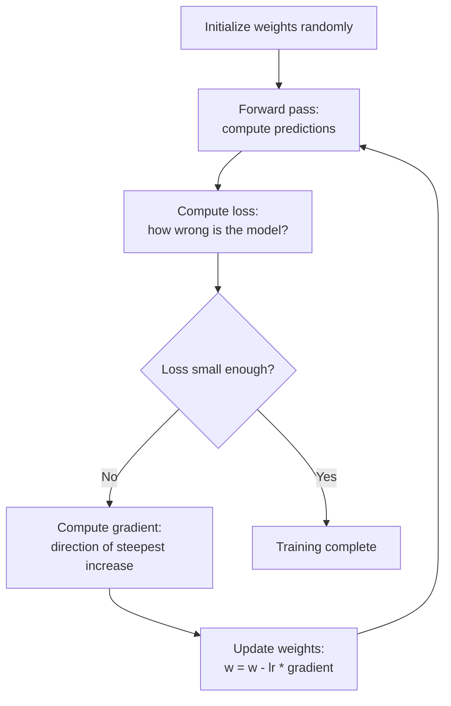

import TawkWidget from '../../../../components/TawkWidget.astro';
import UniversalContentContributors from '../../../../components/UniversalContentContributors.astro';
import InArticleAd from '../../../../components/InArticleAd.astro';
import Copyright from '../../../../components/Copyright.astro';
import BionicText from '../../../../components/BionicText.astro';
import TailwindWrapper from '../../../../components/TailwindWrapper.jsx';
import { Tabs, TabItem } from '@astrojs/starlight/components';
import { Card, CardGrid, Badge, Steps, LinkButton, FileTree } from '@astrojs/starlight/components';

<UniversalContentContributors 
  contributors={frontmatter.contributors}
/>


import MlAiFundamentalsComments from '../../../../components/ml-ai-fundamentals/MlAiFundamentalsComments.astro';

So far, `np.polyfit` and scikit-learn found the best numbers of a model for you. When a fit fails, when the error stops falling, or when training takes hours, you cannot repair a method you have never looked inside. Gradient descent is the method that finds the adjustable numbers of most models, from logistic regression to neural networks. The idea fits in one sentence: measure how wrong the model is, find the direction in which each number should change, take a small step, and repeat. In this lesson you write it yourself in a few lines of NumPy, so that you can watch every number change at every step and recognize the common failures. #GradientDescent #Optimization #MachineLearning

## The blindfolded hill analogy

You stand on a hillside with your eyes covered and want to reach the lowest point of the valley. You feel the slope under your feet, step the way that goes down, feel again, and step again. After many small steps you are at the bottom, or close to it.

That is gradient descent:

- The height of the ground is the **loss**: one number that says how wrong the model is. The **loss function** gives it for every setting of the adjustable numbers, which are called **parameters** or weights.
- The slope you feel is the **gradient**. It points in the direction in which the loss rises fastest, so you step the opposite way.
- The length of your step is set by the **learning rate**.

A hillside has two directions. A model has one direction for each parameter, often thousands, and the rule is the same in every one.

```text
  loss
    │ ●  start
    │  \
    │   \     the gradient points uphill,
    │    \    so each step goes the other way
    │     \
    │      \
    │       \
    │        \______●  lowest loss
    └────────────────────────────────►
          value of one parameter, w
```

Each step applies one rule: the new value of a parameter is its old value minus the learning rate times the gradient.

$$
w_{\text{new}} = w_{\text{old}} - \eta \times \text{gradient}
$$

Here $w$ is a parameter and $\eta$ (the Greek letter eta) is the learning rate, written `lr` in the programs. The whole method is a loop:



## The loss function: how wrong is the model?

<InArticleAd />


Before you can improve a model, you need one number that says how wrong it is. For regression the usual loss function is the **mean squared error** (MSE): the average of the squared differences between the actual values and the predictions.

$$
\text{MSE} = \frac{1}{n} \sum_{i=1}^{n} (y_i - \hat{y}_i)^2
$$

Here $n$ is the number of examples, $y_i$ is the actual value of example $i$, and $\hat{y}_i$ is the prediction for it. The symbol $\sum$ means "add this up for all the examples".

Squaring does two things. It makes every error positive, and it makes large errors count more than small ones. A prediction that is wrong by 10 adds 100 to the sum, and a prediction that is wrong by 1 adds only 1.

## The gradient: which way is downhill?

<InArticleAd />


The gradient of the loss for one parameter says how the loss changes when that parameter rises a little. If the gradient is positive, a higher value gives a higher loss, so you lower the parameter. If it is negative, you raise it.

Take a line with one feature, $\hat{y} = wx + b$, with slope $w$ and intercept $b$. The symbol $\partial \text{MSE} / \partial w$ is read "the change in the MSE for a small change in $w$, with $b$ held still". The two gradients are:

$$
\frac{\partial \text{MSE}}{\partial w} = \frac{-2}{n} \sum_{i=1}^{n} x_i (y_i - \hat{y}_i)
$$

$$
\frac{\partial \text{MSE}}{\partial b} = \frac{-2}{n} \sum_{i=1}^{n} (y_i - \hat{y}_i)
$$

Both come from the MSE formula by the rules of calculus, and for larger models software derives them. Each one is an average of the errors $(y_i - \hat{y}_i)$. When the predictions are too low on average, both gradients are negative, and the update rule raises $w$ and $b$.

## Gradient descent in 25 lines

<InArticleAd />


Here is linear regression fitted by gradient descent alone, with NumPy and no scikit-learn. The data follows $y = 3x + 7$ with noise. One pass of the loop, which uses all the data once, is called an **epoch**.

```python
import numpy as np

np.random.seed(42)

# ── Generate data: y = 3x + 7 + noise ──
n = 100
x = np.random.uniform(0, 10, n)
y = 3 * x + 7 + np.random.randn(n) * 2

# ── Initialize parameters randomly ──
w = np.random.randn()  # weight (slope)
b = np.random.randn()  # bias (intercept)
lr = 0.01              # learning rate
epochs = 2000          # number of iterations

print(f"True parameters:    w = 3.000, b = 7.000")
print(f"Initial parameters: w = {w:.3f}, b = {b:.3f}")
print()

# ── Gradient descent loop ──
losses = []
for epoch in range(epochs):
    # Forward pass: compute predictions
    y_pred = w * x + b

    # Compute loss (MSE)
    loss = np.mean((y - y_pred) ** 2)
    losses.append(loss)

    # Compute gradients
    dw = -2 * np.mean(x * (y - y_pred))  # gradient w.r.t. weight
    db = -2 * np.mean(y - y_pred)         # gradient w.r.t. bias

    # Update parameters (step downhill)
    w = w - lr * dw
    b = b - lr * db

    # Print progress every 200 epochs
    if epoch % 200 == 0 or epoch == epochs - 1:
        print(f"Epoch {epoch:>4d}: loss = {loss:.4f}, w = {w:.4f}, b = {b:.4f}")

print(f"\nFinal parameters: w = {w:.3f}, b = {b:.3f}")
print(f"True parameters:  w = 3.000, b = 7.000")
print(f"Final loss: {losses[-1]:.4f}")
```

The loop ends at about $w = 2.908$ and $b = 7.430$ with a loss of about 3.23: the least-squares line for these 100 noisy points, close to the true 3 and 7 but not equal. $w$ is almost right after 200 epochs, and $b$ needs more than 1,000. The feature $x$ runs from 0 to 10 and is not scaled, so the loss is a long narrow valley: steep in the $w$ direction and nearly flat in the $b$ direction.

That is the complete algorithm, and larger models run the same loop with more parameters.

## Visualizing the learning process

<InArticleAd />


The next program runs the same loop, keeps every value of $w$ and $b$, and plots the loss and the two parameters at each epoch, and the line at five moments of the training.

```python
import numpy as np
import matplotlib.pyplot as plt

np.random.seed(42)

# ── Generate data ──
n = 100
x = np.random.uniform(0, 10, n)
y = 3 * x + 7 + np.random.randn(n) * 2

# ── Gradient descent with history tracking ──
w = np.random.randn()
b = np.random.randn()
lr = 0.01
epochs = 2000

losses = []
w_history = [w]
b_history = [b]

for epoch in range(epochs):
    y_pred = w * x + b
    loss = np.mean((y - y_pred) ** 2)
    losses.append(loss)

    dw = -2 * np.mean(x * (y - y_pred))
    db = -2 * np.mean(y - y_pred)

    w = w - lr * dw
    b = b - lr * db
    w_history.append(w)
    b_history.append(b)

# ── Plot 1: Loss Curve ──
fig, axes = plt.subplots(1, 3, figsize=(16, 5))

axes[0].plot(losses, color='steelblue', linewidth=2)
axes[0].set_xlabel('Epoch')
axes[0].set_ylabel('MSE Loss')
axes[0].set_title('Loss Decreases Over Training')
axes[0].grid(True, alpha=0.3)
axes[0].set_yscale('log')

# ── Plot 2: Parameter Convergence ──
axes[1].plot(w_history, label=f'w (converges to ~3.0)', color='steelblue', linewidth=2)
axes[1].plot(b_history, label=f'b (converges to ~7.0)', color='tomato', linewidth=2)
axes[1].axhline(y=3.0, color='steelblue', linestyle='--', alpha=0.3)
axes[1].axhline(y=7.0, color='tomato', linestyle='--', alpha=0.3)
axes[1].set_xlabel('Epoch')
axes[1].set_ylabel('Parameter Value')
axes[1].set_title('Parameters Converge to True Values')
axes[1].legend()
axes[1].grid(True, alpha=0.3)

# ── Plot 3: Line Fitting Animation (snapshots) ──
x_line = np.linspace(0, 10, 100)
snapshot_epochs = [0, 5, 50, 300, 2000]

axes[2].scatter(x, y, alpha=0.3, s=10, color='gray', label='Data')
colors = plt.cm.viridis(np.linspace(0, 1, len(snapshot_epochs)))

for i, ep in enumerate(snapshot_epochs):
    w_snap = w_history[ep]
    b_snap = b_history[ep]
    y_line = w_snap * x_line + b_snap
    axes[2].plot(x_line, y_line, color=colors[i], linewidth=2,
                 label=f'Epoch {ep}: w={w_snap:.2f}, b={b_snap:.2f}')

axes[2].set_xlabel('x')
axes[2].set_ylabel('y')
axes[2].set_title('Line Fitting Over Training')
axes[2].legend(fontsize=7)
axes[2].grid(True, alpha=0.3)

plt.tight_layout()
plt.savefig('gradient_descent_visualization.png', dpi=100)
plt.show()
print("Plot saved as gradient_descent_visualization.png")
print("\nLeft: the loss drops sharply in early epochs, then levels off.")
print("Middle: both parameters settle close to their true values (w quickly, b slowly).")
print("Right: the line starts random and rotates into place.")
```

## Learning rate: the most important hyperparameter

<InArticleAd />


The learning rate sets the length of each step. It is a **hyperparameter**: a setting that you choose, not a number that the model learns. The program runs the same fit with four learning rates.

```python
import numpy as np
import matplotlib.pyplot as plt

np.random.seed(42)

# ── Generate data ──
n = 100
x = np.random.uniform(0, 10, n)
y = 3 * x + 7 + np.random.randn(n) * 2

# ── Try different learning rates ──
learning_rates = [0.0001, 0.01, 0.05, 0.1]
epochs = 200

fig, axes = plt.subplots(2, 2, figsize=(12, 10))
axes = axes.flatten()

for ax, lr in zip(axes, learning_rates):
    w = np.random.randn()
    b = np.random.randn()
    losses = []
    diverged = False

    for epoch in range(epochs):
        y_pred = w * x + b
        loss = np.mean((y - y_pred) ** 2)

        if np.isnan(loss) or loss > 1e10:
            diverged = True
            losses.append(losses[-1] if losses else 1e10)
            break

        losses.append(loss)
        dw = -2 * np.mean(x * (y - y_pred))
        db = -2 * np.mean(y - y_pred)
        w = w - lr * dw
        b = b - lr * db

    ax.plot(losses, color='steelblue', linewidth=2)
    ax.set_xlabel('Epoch')
    ax.set_ylabel('MSE Loss')
    ax.grid(True, alpha=0.3)

    if diverged:
        ax.set_title(f'lr = {lr}: DIVERGED (too large!)', color='red')
    elif losses[-1] > 10:
        ax.set_title(f'lr = {lr}: Too slow (loss = {losses[-1]:.1f})')
    else:
        ax.set_title(f'lr = {lr}: Final loss = {losses[-1]:.4f}')

    ax.set_yscale('log')

plt.suptitle('Effect of Learning Rate on Training', fontsize=14, y=1.01)
plt.tight_layout()
plt.savefig('learning_rate_comparison.png', dpi=100)
plt.show()

print("Learning rate effects:")
print(f"  lr = 0.0001: Too small. The loss is still far from the minimum after 200 epochs.")
print(f"  lr = 0.01:   Good. The loss falls smoothly.")
print(f"  lr = 0.05:   Too large. Every step overshoots and the loss explodes.")
print(f"  lr = 0.1:    Far too large. The loss explodes within a few steps.")
print(f"  For this unscaled data the largest stable learning rate is about 0.03.")
print(f"\nPlot saved as learning_rate_comparison.png")
```

With a learning rate that is too small (0.0001 here), every step goes the right way and almost nothing happens. After 200 epochs the loss is still 47:

```text
  loss
    │●●●●●●
    │      ●●●●●●●
    │             ●●●●●●●●
    │                     ●●●●●●●●●●
    └──────────────────────────────────►
                  epochs
```

With a good learning rate (0.01) the loss falls fast and then levels off near its lowest value:

```text
  loss
    │●
    │ ●
    │  ●●
    │    ●●●●
    │        ●●●●●●●●●●●●●●●●●●●●●●●
    └──────────────────────────────────►
                  epochs
```

With a learning rate that is too large (0.05 or 0.1), every step jumps past the lowest point and lands higher on the other side, and the loss grows without end:

```text
  loss
    │                            ●
    │                         ●
    │                     ●
    │              ●
    │●●●   ●
    └──────────────────────────────────►
                  epochs
```

## Connection to PID control

<InArticleAd />


Gradient descent is a feedback loop. A controller measures an error, corrects in proportion to it, and repeats; gradient descent corrects each parameter in proportion to its gradient, and repeats.

| Control loop | Gradient descent |
|---|---|
| Error signal | Gradient of the loss |
| Controller gain | Learning rate |
| Controller output | Change made to the parameters |
| Response of the plant | New predictions and a new loss |

The learning rate behaves as the gain does. Too low, and the loop is slow. Too high, and it overshoots, oscillates and at last runs away.

<Card title="Connect to Applied Math" icon="star">
For a straight-line model the best parameters can be calculated directly, by setting the derivative of the loss to zero and solving the equations that result (the normal equations). This is what `np.polyfit` does. Gradient descent is for the models where those equations cannot be solved directly, such as logistic regression and neural networks.
</Card>

## Multivariate gradient descent

<InArticleAd />


The same method works with several features: one weight for each feature, and one gradient for each weight. The program below has three features. It scales them first, so that the loss is a round bowl, equally steep in every direction, and one learning rate fits all the weights.

```python
import numpy as np
import matplotlib.pyplot as plt

np.random.seed(42)

# ── Generate multi-feature data ──
# True relationship: y = 2*x1 + (-1)*x2 + 0.5*x3 + 5 + noise
n = 200
X = np.random.randn(n, 3)
w_true = np.array([2.0, -1.0, 0.5])
b_true = 5.0
y = X @ w_true + b_true + np.random.randn(n) * 0.5

# ── Feature scaling (important for gradient descent) ──
X_mean = X.mean(axis=0)
X_std = X.std(axis=0)
X_scaled = (X - X_mean) / X_std

# ── Gradient descent ──
w = np.random.randn(3)
b = 0.0
lr = 0.05
epochs = 300

losses = []

print(f"True parameters:    w = {w_true}, b = {b_true:.1f}")
print(f"Initial parameters: w = [{w[0]:.3f}, {w[1]:.3f}, {w[2]:.3f}], b = {b:.3f}")
print()

for epoch in range(epochs):
    # Forward pass
    y_pred = X_scaled @ w + b

    # Loss
    loss = np.mean((y - y_pred) ** 2)
    losses.append(loss)

    # Gradients (vectorized)
    error = y - y_pred
    dw = -2 / n * (X_scaled.T @ error)   # shape: (3,)
    db = -2 / n * np.sum(error)           # scalar

    # Update
    w = w - lr * dw
    b = b - lr * db

    if epoch % 50 == 0 or epoch == epochs - 1:
        print(f"Epoch {epoch:>4d}: loss = {loss:.4f}, w = [{w[0]:.3f}, {w[1]:.3f}, {w[2]:.3f}], b = {b:.3f}")

# ── Unscale weights to compare with true values ──
w_unscaled = w / X_std
b_unscaled = b - np.sum(w * X_mean / X_std)

print(f"\nFinal (unscaled): w = [{w_unscaled[0]:.3f}, {w_unscaled[1]:.3f}, {w_unscaled[2]:.3f}], b = {b_unscaled:.3f}")
print(f"True:             w = [{w_true[0]:.3f}, {w_true[1]:.3f}, {w_true[2]:.3f}], b = {b_true:.3f}")

# ── Plot loss curve ──
plt.figure(figsize=(8, 5))
plt.plot(losses, color='steelblue', linewidth=2)
plt.xlabel('Epoch')
plt.ylabel('MSE Loss')
plt.title('Multivariate Gradient Descent: Loss Curve')
plt.grid(True, alpha=0.3)
plt.yscale('log')
plt.tight_layout()
plt.savefig('multivariate_gd_loss.png', dpi=100)
plt.show()
print("\nPlot saved as multivariate_gd_loss.png")
```

With scaled features the loss reaches its lowest value, 0.25, within about 100 epochs, at a learning rate five times larger than before.

## Batch vs stochastic gradient descent

<InArticleAd />


So far every step used all the training samples to calculate the gradient. This is **batch gradient descent**. With a million samples each step is slow, so there are two other ways:

| Method | Samples used for each step | Behaviour |
|---|---|---|
| Batch | All of them | Smooth and steady, but each step is slow on a large data set |
| Stochastic (SGD) | One, chosen at random | Each step is very fast, but the path is noisy and zig-zags |
| Mini-batch | A random group, often 32 or 64 | Faster than batch and smoother than SGD |

Mini-batch is the usual choice, and it is how neural networks are trained.

```python
import numpy as np
import matplotlib.pyplot as plt

np.random.seed(42)

# ── Generate data ──
n = 200
x = np.random.uniform(0, 10, n)
y = 3 * x + 7 + np.random.randn(n) * 2

# ── Batch Gradient Descent ──
def run_gd(x, y, mode='batch', batch_size=32, lr=0.01, epochs=100):
    """Run gradient descent in batch, stochastic, or mini-batch mode."""
    np.random.seed(42)
    w, b = np.random.randn(), np.random.randn()
    losses = []

    for epoch in range(epochs):
        # Full loss for tracking (always computed on all data)
        y_pred_full = w * x + b
        losses.append(np.mean((y - y_pred_full) ** 2))

        if mode == 'batch':
            # Use all data
            x_batch, y_batch = x, y
        elif mode == 'sgd':
            # Use one random sample
            idx = np.random.randint(0, len(x))
            x_batch, y_batch = x[idx:idx+1], y[idx:idx+1]
        elif mode == 'mini-batch':
            # Use a random subset
            idx = np.random.choice(len(x), batch_size, replace=False)
            x_batch, y_batch = x[idx], y[idx]

        y_pred = w * x_batch + b
        dw = -2 * np.mean(x_batch * (y_batch - y_pred))
        db = -2 * np.mean(y_batch - y_pred)
        w -= lr * dw
        b -= lr * db

    return losses, w, b

# ── Run all three modes ──
# Here one "epoch" is one parameter update (one step), so that the
# three modes are compared step for step.
epochs = 2000
losses_batch, w_b, b_b = run_gd(x, y, mode='batch', lr=0.01, epochs=epochs)
losses_sgd, w_s, b_s = run_gd(x, y, mode='sgd', lr=0.01, epochs=epochs)
losses_mini, w_m, b_m = run_gd(x, y, mode='mini-batch', batch_size=32, lr=0.01, epochs=epochs)

print(f"{'Mode':<15} {'Final Loss':<12} {'w':<10} {'b':<10}")
print("-" * 47)
print(f"{'Batch':<15} {losses_batch[-1]:<12.4f} {w_b:<10.4f} {b_b:<10.4f}")
print(f"{'SGD':<15} {losses_sgd[-1]:<12.4f} {w_s:<10.4f} {b_s:<10.4f}")
print(f"{'Mini-batch':<15} {losses_mini[-1]:<12.4f} {w_m:<10.4f} {b_m:<10.4f}")
print(f"{'True':<15} {'':12s} {'3.0000':<10} {'7.0000':<10}")

# ── Plot ──
fig, axes = plt.subplots(1, 3, figsize=(16, 5))

modes = [('Batch', losses_batch, 'steelblue'),
         ('SGD', losses_sgd, 'tomato'),
         ('Mini-batch (32)', losses_mini, 'seagreen')]

for ax, (name, losses, color) in zip(axes, modes):
    ax.plot(losses, color=color, linewidth=1.5, alpha=0.8)
    ax.set_xlabel('Epoch')
    ax.set_ylabel('MSE Loss')
    ax.set_title(f'{name}: Final loss = {losses[-1]:.4f}')
    ax.grid(True, alpha=0.3)
    ax.set_yscale('log')

plt.suptitle('Batch vs SGD vs Mini-Batch Gradient Descent', fontsize=13)
plt.tight_layout()
plt.savefig('gd_modes_comparison.png', dpi=100)
plt.show()

print("\nNotice:")
print("  Batch: smooth, steady descent.")
print("  SGD: noisy, zig-zag path (each step uses one sample).")
print("  Mini-batch: moderate noise, good balance.")
print("\nPlot saved as gd_modes_comparison.png")
```

After 2,000 steps the three are close to each other: batch gives $w = 2.98$ and $b = 7.21$, SGD gives 2.83 and 7.62, and mini-batch gives 2.95 and 7.17. The loss of SGD jumps up and down on the way, because each step looks at one sample only.

## Beyond vanilla gradient descent

<InArticleAd />


The plain rule `w -= lr * gradient` is called **vanilla** gradient descent. Libraries offer variants that improve it in two ways. **Momentum** keeps part of the previous step, so steps in a steady direction add up and zig-zags cancel. An **adaptive learning rate** gives every parameter its own step size.

```text
  Vanilla:         w -= lr * g
  Momentum:        v = beta*v + g;   w -= lr * v
  Adam (default):  tracks running mean AND variance of g,
                   adjusts step size for every parameter
```

Adam combines both and is the usual first choice in PyTorch (`torch.optim.Adam`) and in TensorFlow. It usually needs fewer steps and is less sensitive to the learning rate. Every variant still calculates the same gradient and still steps downhill.

A **learning rate schedule** is another common tool: start with larger steps and make them smaller as training goes on.

<Card title="Why linear regression always arrives and a neural network may not" icon="star">
The loss of linear regression (and of logistic regression) is **convex**: one bowl with one lowest point. Gradient descent reaches it from any start, if the learning rate is small enough.

The loss of a neural network is **not convex**. It has many low points, and gradient descent stops in the one it reaches first, which need not be the lowest. In practice many of them give models that work about equally well.
</Card>

## The complete gradient descent lab

<InArticleAd />


This last program joins the parts: gradient descent written by hand, plots of its progress, and a comparison with the exact answer that scikit-learn calculates directly.

```python
import numpy as np
import matplotlib.pyplot as plt
from sklearn.linear_model import LinearRegression

np.random.seed(42)

# ── Generate data ──
n = 150
x = np.random.uniform(0, 10, n)
y = 3 * x + 7 + np.random.randn(n) * 2

# ── Gradient Descent Implementation ──
def gradient_descent(x, y, lr=0.01, epochs=500):
    w, b = 0.0, 0.0
    losses, ws, bs = [], [], []

    for epoch in range(epochs):
        y_pred = w * x + b
        loss = np.mean((y - y_pred) ** 2)
        losses.append(loss)
        ws.append(w)
        bs.append(b)

        dw = -2 * np.mean(x * (y - y_pred))
        db = -2 * np.mean(y - y_pred)
        w -= lr * dw
        b -= lr * db

    return w, b, losses, ws, bs

# ── Run gradient descent ──
w_gd, b_gd, losses, ws, bs = gradient_descent(x, y, lr=0.01, epochs=3000)

# ── Compare with scikit-learn (closed-form solution) ──
lr_model = LinearRegression()
lr_model.fit(x.reshape(-1, 1), y)
w_sklearn = lr_model.coef_[0]
b_sklearn = lr_model.intercept_

print("=" * 50)
print("GRADIENT DESCENT vs CLOSED-FORM SOLUTION")
print("=" * 50)
print(f"\n{'Method':<25} {'w (slope)':<12} {'b (intercept)':<14} {'MSE':<10}")
print("-" * 61)
print(f"{'True values':<25} {'3.000':<12} {'7.000':<14}")
print(f"{'Gradient descent':<25} {w_gd:<12.4f} {b_gd:<14.4f} {losses[-1]:<10.4f}")
y_sk_pred = lr_model.predict(x.reshape(-1, 1))
mse_sk = np.mean((y - y_sk_pred) ** 2)
print(f"{'scikit-learn (exact)':<25} {w_sklearn:<12.4f} {b_sklearn:<14.4f} {mse_sk:<10.4f}")

print(f"\nDifference in parameters:")
print(f"  |w_gd - w_exact| = {abs(w_gd - w_sklearn):.6f}")
print(f"  |b_gd - b_exact| = {abs(b_gd - b_sklearn):.6f}")
print(f"\nGradient descent converges to the same answer as the exact solution.")

# ── Full visualization ──
fig, axes = plt.subplots(2, 2, figsize=(14, 10))

# Plot 1: Loss curve
axes[0, 0].plot(losses, color='steelblue', linewidth=2)
axes[0, 0].set_xlabel('Epoch')
axes[0, 0].set_ylabel('MSE Loss')
axes[0, 0].set_title('Loss Curve (log scale)')
axes[0, 0].set_yscale('log')
axes[0, 0].grid(True, alpha=0.3)

# Plot 2: Parameter convergence
axes[0, 1].plot(ws, label=f'w (final: {w_gd:.3f})', color='steelblue', linewidth=2)
axes[0, 1].plot(bs, label=f'b (final: {b_gd:.3f})', color='tomato', linewidth=2)
axes[0, 1].axhline(y=w_sklearn, color='steelblue', linestyle='--', alpha=0.4, label=f'w exact: {w_sklearn:.3f}')
axes[0, 1].axhline(y=b_sklearn, color='tomato', linestyle='--', alpha=0.4, label=f'b exact: {b_sklearn:.3f}')
axes[0, 1].set_xlabel('Epoch')
axes[0, 1].set_ylabel('Parameter Value')
axes[0, 1].set_title('Parameters Converge to Exact Solution')
axes[0, 1].legend(fontsize=8)
axes[0, 1].grid(True, alpha=0.3)

# Plot 3: Final fit
x_line = np.linspace(0, 10, 100)
axes[1, 0].scatter(x, y, alpha=0.4, s=15, color='gray')
axes[1, 0].plot(x_line, w_gd * x_line + b_gd, color='steelblue', linewidth=2,
                label=f'GD: y = {w_gd:.2f}x + {b_gd:.2f}')
axes[1, 0].plot(x_line, w_sklearn * x_line + b_sklearn, color='tomato', linewidth=2,
                linestyle='--', label=f'Exact: y = {w_sklearn:.2f}x + {b_sklearn:.2f}')
axes[1, 0].set_xlabel('x')
axes[1, 0].set_ylabel('y')
axes[1, 0].set_title('GD vs Exact Solution (they overlap)')
axes[1, 0].legend()
axes[1, 0].grid(True, alpha=0.3)

# Plot 4: Loss landscape contour with GD path
w_range = np.linspace(0, 6, 100)
b_range = np.linspace(0, 14, 100)
W, B = np.meshgrid(w_range, b_range)
Z = np.zeros_like(W)
for i in range(W.shape[0]):
    for j in range(W.shape[1]):
        y_pred = W[i, j] * x + B[i, j]
        Z[i, j] = np.mean((y - y_pred) ** 2)

axes[1, 1].contour(W, B, Z, levels=30, cmap='viridis', alpha=0.6)
axes[1, 1].plot(ws, bs, 'r.-', markersize=1, linewidth=1, alpha=0.7, label='GD path')
axes[1, 1].plot(ws[0], bs[0], 'go', markersize=8, label='Start')
axes[1, 1].plot(ws[-1], bs[-1], 'r*', markersize=12, label='End')
axes[1, 1].plot(w_sklearn, b_sklearn, 'kx', markersize=10, markeredgewidth=2, label='Exact minimum')
axes[1, 1].set_xlabel('w (weight)')
axes[1, 1].set_ylabel('b (bias)')
axes[1, 1].set_title('Loss Landscape with GD Path')
axes[1, 1].legend(fontsize=8)
axes[1, 1].grid(True, alpha=0.3)

plt.tight_layout()
plt.savefig('gradient_descent_complete.png', dpi=100)
plt.show()
print("\nPlot saved as gradient_descent_complete.png")
print("\nBottom-right: the contour plot shows the loss landscape.")
print("The GD path (red) starts at w = 0, b = 0 and follows the")
print("gradient downhill to the minimum (black X).")
```

Gradient descent and the exact method agree to six decimal places: $w = 3.0350$ and $b = 6.9283$.

## Key takeaways

<InArticleAd />


<Steps>
1. **Gradient descent is one loop.** Predict, compute the loss, compute the gradient, update the parameters.

2. **The loss function measures how wrong the model is.** MSE for regression, cross-entropy for classification.

3. **The gradient points uphill, and you step downhill.** The update rule is `parameters -= learning_rate * gradient`.

4. **The learning rate decides whether training works.** Too large, and the loss grows without end. Too small, and training takes far too long. Start with 0.01 and adjust.

5. **Scale the features.** Features on different scales make the loss steep in one direction and flat in another, and no single learning rate fits both.

6. **Gradient descent and the exact solution agree.** Gradient descent is for the models that have no exact solution.

7. **Mini-batch is the practical choice.** It is faster than batch and steadier than SGD.
</Steps>

## What is next

<InArticleAd />


Next, in [Neural Networks from Scratch](/education/ml-ai-fundamentals/neural-networks-from-scratch/), you build a neural network with NumPy alone. Its forward pass is matrix multiplication, and its training is gradient descent applied to every layer.

<MlAiFundamentalsComments />


<InArticleAd />
<TawkWidget />
<Copyright />
