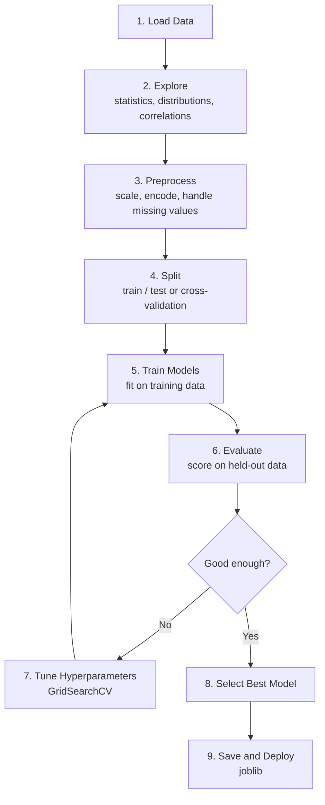

import TawkWidget from '../../../../components/TawkWidget.astro';
import UniversalContentContributors from '../../../../components/UniversalContentContributors.astro';
import InArticleAd from '../../../../components/InArticleAd.astro';
import Copyright from '../../../../components/Copyright.astro';
import BionicText from '../../../../components/BionicText.astro';
import TailwindWrapper from '../../../../components/TailwindWrapper.jsx';
import { Tabs, TabItem } from '@astrojs/starlight/components';
import { Card, CardGrid, Badge, Steps, LinkButton, FileTree } from '@astrojs/starlight/components';

<UniversalContentContributors 
  contributors={frontmatter.contributors}
/>


import MlAiFundamentalsComments from '../../../../components/ml-ai-fundamentals/MlAiFundamentalsComments.astro';

You try a model, the score looks good, and on next month's readings it is far worse. Often the model is not at fault: information about the test rows reached it, or one lucky division of the data flattered it. Scikit-learn, a free Python library for machine learning (ML), gives every model the same few commands, so one careful way of working serves every project. Here you build it for the energy use of a building: five models compared fairly, the best one tuned, tested once on rows it has never seen, and saved. #ScikitLearn #MLPipeline #CrossValidation

## The ML Workflow

A model is a rule with adjustable numbers, changed in training until its answers match a table of examples. Every project does this in the same order:



Three words are needed before the first program:

- **R-squared (R2)** is the score used here: the share of the variation in the measured values that the model explains. 1 is perfect. 0 is no better than answering the average every time.
- A **hyperparameter** is a setting you choose before training, such as the depth of a tree.
- **Scaling** changes each input so that its mean is 0 and its standard deviation is 1. Then an input with large numbers (light in lux) cannot outweigh one with small numbers (wind in m/s).

### Why the data is divided (step 4)

A flexible model can match its examples by remembering them. On the data of this lesson, a decision tree with no depth limit scores R2 = 1.00 on the 800 rows it was fitted to, and 0.58 on 200 rows it has never seen. So the model is fitted to a **training set**, and a **test set** is kept away from every step and used once, at the end, to estimate how the model will do on new readings.

<Card title="Why pipelines?" icon="star">
A scaler learns a mean and a standard deviation from the rows you give it. If it learns them from all the rows before the division, it has used the test rows. This is **data leakage**, and it makes scores look better than they are. A `Pipeline` joins the scaler and the model in one object, so the scaler is fitted on the training rows only.
</Card>

## Generate a Realistic Dataset

<InArticleAd />


The practice task is to predict the energy a building uses (`power_kwh`, the **target**) from eight readings, such as the number of people and the outdoor temperature. Predicting a number, not a class, is called **regression**. The program makes 1,000 rows from a known formula.

```python
import numpy as np
import pandas as pd

np.random.seed(42)

n_samples = 1000

# Features: building sensor readings
hour = np.random.randint(0, 24, n_samples)
day_of_week = np.random.randint(0, 7, n_samples)
temperature_c = np.random.normal(22, 8, n_samples)
humidity_pct = np.random.normal(50, 15, n_samples).clip(10, 95)
occupancy = np.random.poisson(lam=30, size=n_samples).clip(0, 120)
light_level_lux = np.random.normal(400, 150, n_samples).clip(0, 1000)
hvac_setpoint_c = np.random.normal(22, 2, n_samples)
wind_speed_ms = np.random.exponential(3, n_samples).clip(0, 20)

# Target: power consumption (kWh) with realistic relationships
power_kwh = (
    50                                          # base load
    + 2.5 * occupancy                           # more people, more power
    + 3.0 * np.abs(temperature_c - hvac_setpoint_c)  # HVAC effort
    + 0.5 * humidity_pct                        # dehumidification
    + 0.02 * light_level_lux                    # lighting
    + 15 * np.sin(2 * np.pi * hour / 24)        # daily cycle
    + np.where(day_of_week < 5, 20, -10)         # weekday vs weekend
    + np.random.normal(0, 10, n_samples)        # noise
)

data = pd.DataFrame({
    'hour': hour,
    'day_of_week': day_of_week,
    'temperature_c': np.round(temperature_c, 1),
    'humidity_pct': np.round(humidity_pct, 1),
    'occupancy': occupancy,
    'light_level_lux': np.round(light_level_lux, 1),
    'hvac_setpoint_c': np.round(hvac_setpoint_c, 1),
    'wind_speed_ms': np.round(wind_speed_ms, 1),
    'power_kwh': np.round(power_kwh, 1)
})

print("Dataset shape:", data.shape)
print("\nFirst 5 rows:")
print(data.head().to_string())
print("\nSummary statistics:")
print(data.describe().round(2).to_string())
print("\nCorrelation with power_kwh:")
correlations = data.corr()['power_kwh'].drop('power_kwh').sort_values(ascending=False)
print(correlations.round(3).to_string())
```

**Expected output (shortened):**

```text
Dataset shape: (1000, 9)

First 5 rows:
   hour  day_of_week  temperature_c  humidity_pct  occupancy  ...
0     6            6           10.4          72.8         28  ...

Summary statistics:
          hour  day_of_week  temperature_c  ...  power_kwh
count  1000.00      1000.00        1000.00  ...    1000.00
mean     11.43         2.98          22.18  ...     188.28
std       7.15         2.00           7.97  ...      29.60
...

Correlation with power_kwh:
occupancy          0.474
humidity_pct       0.262
light_level_lux    0.056
hvac_setpoint_c    0.053
temperature_c      0.022
wind_speed_ms      0.014
hour              -0.262
day_of_week       -0.339
```

A correlation is a number from -1 to 1 that says how closely two columns move together along a straight line. Occupancy has the strongest correlation with power, which matches the formula.

A correlation sees only straight-line relations. The heating and cooling (HVAC) term grows when the temperature is far from the setpoint in either direction. So temperature has a correlation of only 0.022 with power, although it drives one of the largest terms.

## Data Preprocessing with Pipelines

<InArticleAd />

The next program divides the rows into 800 for training and 200 for testing. Its pipeline has two steps: a scaler, and `PolynomialFeatures`, which adds the squares of the inputs and the products of every pair so that a straight-line model can follow a curve.

```python
import numpy as np
import pandas as pd
from sklearn.model_selection import train_test_split
from sklearn.preprocessing import StandardScaler, PolynomialFeatures
from sklearn.pipeline import Pipeline

np.random.seed(42)

# (Regenerate the dataset from above, or assume 'data' is already loaded)
# For a self-contained script, we regenerate:
n_samples = 1000
hour = np.random.randint(0, 24, n_samples)
day_of_week = np.random.randint(0, 7, n_samples)
temperature_c = np.random.normal(22, 8, n_samples)
humidity_pct = np.random.normal(50, 15, n_samples).clip(10, 95)
occupancy = np.random.poisson(lam=30, size=n_samples).clip(0, 120)
light_level_lux = np.random.normal(400, 150, n_samples).clip(0, 1000)
hvac_setpoint_c = np.random.normal(22, 2, n_samples)
wind_speed_ms = np.random.exponential(3, n_samples).clip(0, 20)

power_kwh = (
    50 + 2.5 * occupancy
    + 3.0 * np.abs(temperature_c - hvac_setpoint_c)
    + 0.5 * humidity_pct + 0.02 * light_level_lux
    + 15 * np.sin(2 * np.pi * hour / 24)
    + np.where(day_of_week < 5, 20, -10)
    + np.random.normal(0, 10, n_samples)
)

data = pd.DataFrame({
    'hour': hour, 'day_of_week': day_of_week,
    'temperature_c': np.round(temperature_c, 1),
    'humidity_pct': np.round(humidity_pct, 1),
    'occupancy': occupancy,
    'light_level_lux': np.round(light_level_lux, 1),
    'hvac_setpoint_c': np.round(hvac_setpoint_c, 1),
    'wind_speed_ms': np.round(wind_speed_ms, 1),
    'power_kwh': np.round(power_kwh, 1)
})

X = data.drop('power_kwh', axis=1)
y = data['power_kwh']

X_train, X_test, y_train, y_test = train_test_split(
    X, y, test_size=0.2, random_state=42
)

print(f"Training set: {X_train.shape[0]} samples")
print(f"Test set:     {X_test.shape[0]} samples")

# Build a pipeline: scale, then add polynomial features
preprocessing_pipe = Pipeline([
    ('scaler', StandardScaler()),
    ('poly', PolynomialFeatures(degree=2, include_bias=False)),
])

# Fit only on training data (no data leakage)
X_train_processed = preprocessing_pipe.fit_transform(X_train)
X_test_processed = preprocessing_pipe.transform(X_test)

print(f"\nOriginal features: {X_train.shape[1]}")
print(f"After polynomial expansion: {X_train_processed.shape[1]}")
```

**Expected output:**

```text
Training set: 800 samples
Test set:     200 samples

Original features: 8
After polynomial expansion: 44
```

`fit_transform` on the training rows learns the mean and the standard deviation and applies them. `transform` on the test rows only applies what was learned.

`PolynomialFeatures` adds columns fast: 8 inputs become 44 at `degree=2` and 164 at `degree=3`. More columns give the model more room to remember its examples. Ridge and Lasso, used below, are linear models with a penalty that limits this.

## Cross-Validation and Model Comparison

<InArticleAd />


One division into training rows and test rows can be lucky or unlucky: on this data, the Gradient Boosting model below scores anywhere from about 0.74 to 0.84 on 200 test rows, depending only on which rows fell into the test set. **Cross-validation** cuts the rows into 5 equal parts, called folds, trains the model 5 times, each time on 4 folds, scores it on the fold left out, and averages the 5 scores.

```text
  ┌──────┬──────┬──────┬──────┬──────┐
  │Fold 1│Fold 2│Fold 3│Fold 4│Fold 5│
  └──────┴──────┴──────┴──────┴──────┘

  Run 1:  TEST   Train  Train  Train  Train  -> score1
  Run 2:  Train  TEST   Train  Train  Train  -> score2
  Run 3:  Train  Train  TEST   Train  Train  -> score3
  Run 4:  Train  Train  Train  TEST   Train  -> score4
  Run 5:  Train  Train  Train  Train  TEST   -> score5

  Final score = mean of the 5 scores.
  Every row is scored once, by a model that did not see it.
```

<Card title="Choose the division that fits your data" icon="star">
Plain folds are right here, because the rows do not depend on each other. Two cases need another division:

- **Rare classes.** `StratifiedKFold(n_splits=5)` keeps the same share of each class in every fold. Scikit-learn uses it by itself when you pass `cv=5` with a classifier.
- **Readings in time order.** `TimeSeriesSplit(n_splits=5)` always trains on the past and scores on what follows. [Working with Real Sensor Data](/education/ml-ai-fundamentals/working-with-real-sensor-data/) uses this rule.

With the wrong division the score looks good and the model fails in use.
</Card>

The program runs five models through the same folds. Random Forest and Gradient Boosting are built from many decision trees.

```python
import numpy as np
import pandas as pd
from sklearn.model_selection import train_test_split, cross_val_score
from sklearn.preprocessing import StandardScaler
from sklearn.pipeline import Pipeline
from sklearn.linear_model import LinearRegression, Ridge, Lasso
from sklearn.ensemble import RandomForestRegressor, GradientBoostingRegressor

np.random.seed(42)

# Regenerate dataset
n_samples = 1000
hour = np.random.randint(0, 24, n_samples)
day_of_week = np.random.randint(0, 7, n_samples)
temperature_c = np.random.normal(22, 8, n_samples)
humidity_pct = np.random.normal(50, 15, n_samples).clip(10, 95)
occupancy = np.random.poisson(lam=30, size=n_samples).clip(0, 120)
light_level_lux = np.random.normal(400, 150, n_samples).clip(0, 1000)
hvac_setpoint_c = np.random.normal(22, 2, n_samples)
wind_speed_ms = np.random.exponential(3, n_samples).clip(0, 20)

power_kwh = (
    50 + 2.5 * occupancy
    + 3.0 * np.abs(temperature_c - hvac_setpoint_c)
    + 0.5 * humidity_pct + 0.02 * light_level_lux
    + 15 * np.sin(2 * np.pi * hour / 24)
    + np.where(day_of_week < 5, 20, -10)
    + np.random.normal(0, 10, n_samples)
)

data = pd.DataFrame({
    'hour': hour, 'day_of_week': day_of_week,
    'temperature_c': np.round(temperature_c, 1),
    'humidity_pct': np.round(humidity_pct, 1),
    'occupancy': occupancy,
    'light_level_lux': np.round(light_level_lux, 1),
    'hvac_setpoint_c': np.round(hvac_setpoint_c, 1),
    'wind_speed_ms': np.round(wind_speed_ms, 1),
    'power_kwh': np.round(power_kwh, 1)
})

X = data.drop('power_kwh', axis=1)
y = data['power_kwh']

# Define models inside pipelines (each has its own scaler)
models = {
    'Linear Regression': Pipeline([
        ('scaler', StandardScaler()),
        ('model', LinearRegression()),
    ]),
    'Ridge (alpha=1.0)': Pipeline([
        ('scaler', StandardScaler()),
        ('model', Ridge(alpha=1.0)),
    ]),
    'Lasso (alpha=1.0)': Pipeline([
        ('scaler', StandardScaler()),
        ('model', Lasso(alpha=1.0)),
    ]),
    'Random Forest': Pipeline([
        ('scaler', StandardScaler()),
        ('model', RandomForestRegressor(
            n_estimators=100, max_depth=10, random_state=42
        )),
    ]),
    'Gradient Boosting': Pipeline([
        ('scaler', StandardScaler()),
        ('model', GradientBoostingRegressor(
            n_estimators=100, max_depth=5, random_state=42
        )),
    ]),
}

print("5-Fold Cross-Validation Results (R-squared)")
print("=" * 55)

results = {}
for name, pipeline in models.items():
    scores = cross_val_score(pipeline, X, y, cv=5, scoring='r2')
    results[name] = scores
    print(f"{name:25s} | Mean R2: {scores.mean():.4f} "
          f"(+/- {scores.std():.4f})")

print("\nBest model:", max(results, key=lambda k: results[k].mean()))
# R-squared is bounded above by 1.0 but can go negative when a model
# predicts worse than just using the mean of y. A negative CV score is
# a red flag: check for broken preprocessing, wrong target, or a bug.
```

**Expected output (approximate):**

```text
5-Fold Cross-Validation Results (R-squared)
=======================================================
Linear Regression         | Mean R2: 0.4660 (+/- 0.0376)
Ridge (alpha=1.0)         | Mean R2: 0.4660 (+/- 0.0375)
Lasso (alpha=1.0)         | Mean R2: 0.4670 (+/- 0.0293)
Random Forest             | Mean R2: 0.7434 (+/- 0.0290)
Gradient Boosting         | Mean R2: 0.7851 (+/- 0.0260)

Best model: Gradient Boosting
```

Gradient Boosting gives the best score, because models built from trees can follow relations that are not straight lines, such as the HVAC term. The three linear models reach an R2 of about 0.47. The models built from trees reach 0.74 to 0.79.

To stay short, this comparison used all 1,000 rows. In a real project, set the test rows aside first, as the tuning program below does.

## Hyperparameter Tuning with GridSearchCV

<InArticleAd />


**Tuning** searches for better hyperparameters. `GridSearchCV` takes a list of values for each one, tries every combination, and scores each by cross-validation inside the training set. The test set takes no part. If you chose the settings by their test score, no unseen rows would be left to judge the model.

<Card title="Grid search or randomized search" icon="information">
`GridSearchCV` fits every combination: 3 x 3 x 3 values with 5 folds is 135 fits, and each added hyperparameter multiplies the count. Past a few hundred combinations, use `RandomizedSearchCV`. It tries a fixed number of random combinations (`n_iter=50`) and usually finds settings almost as good in far less time.
</Card>

```python
import numpy as np
import pandas as pd
from sklearn.model_selection import train_test_split, GridSearchCV
from sklearn.preprocessing import StandardScaler
from sklearn.pipeline import Pipeline
from sklearn.ensemble import GradientBoostingRegressor

np.random.seed(42)

# Regenerate dataset (same as above)
n_samples = 1000
hour = np.random.randint(0, 24, n_samples)
day_of_week = np.random.randint(0, 7, n_samples)
temperature_c = np.random.normal(22, 8, n_samples)
humidity_pct = np.random.normal(50, 15, n_samples).clip(10, 95)
occupancy = np.random.poisson(lam=30, size=n_samples).clip(0, 120)
light_level_lux = np.random.normal(400, 150, n_samples).clip(0, 1000)
hvac_setpoint_c = np.random.normal(22, 2, n_samples)
wind_speed_ms = np.random.exponential(3, n_samples).clip(0, 20)

power_kwh = (
    50 + 2.5 * occupancy
    + 3.0 * np.abs(temperature_c - hvac_setpoint_c)
    + 0.5 * humidity_pct + 0.02 * light_level_lux
    + 15 * np.sin(2 * np.pi * hour / 24)
    + np.where(day_of_week < 5, 20, -10)
    + np.random.normal(0, 10, n_samples)
)

data = pd.DataFrame({
    'hour': hour, 'day_of_week': day_of_week,
    'temperature_c': np.round(temperature_c, 1),
    'humidity_pct': np.round(humidity_pct, 1),
    'occupancy': occupancy,
    'light_level_lux': np.round(light_level_lux, 1),
    'hvac_setpoint_c': np.round(hvac_setpoint_c, 1),
    'wind_speed_ms': np.round(wind_speed_ms, 1),
    'power_kwh': np.round(power_kwh, 1)
})

X = data.drop('power_kwh', axis=1)
y = data['power_kwh']
X_train, X_test, y_train, y_test = train_test_split(
    X, y, test_size=0.2, random_state=42
)

# Pipeline with tunable parameters
pipe = Pipeline([
    ('scaler', StandardScaler()),
    ('model', GradientBoostingRegressor(random_state=42)),
])

# Parameter grid (prefix parameter names with step name + __)
param_grid = {
    'model__n_estimators': [50, 100, 200],
    'model__max_depth': [3, 5, 7],
    'model__learning_rate': [0.05, 0.1, 0.2],
}

# GridSearchCV tries all combinations (3 x 3 x 3 = 27 fits x 5 folds = 135 fits)
grid_search = GridSearchCV(
    pipe, param_grid, cv=5, scoring='r2',
    n_jobs=-1, verbose=0
)

print("Running GridSearchCV (27 combinations x 5 folds = 135 fits)...")
grid_search.fit(X_train, y_train)

print(f"\nBest parameters: {grid_search.best_params_}")
print(f"Best CV R2 score: {grid_search.best_score_:.4f}")

# Evaluate on held-out test set
test_score = grid_search.score(X_test, y_test)
print(f"Test R2 score:    {test_score:.4f}")

# Show top 5 parameter combinations
results_df = pd.DataFrame(grid_search.cv_results_)
top5 = results_df.nsmallest(5, 'rank_test_score')[
    ['param_model__n_estimators', 'param_model__max_depth',
     'param_model__learning_rate', 'mean_test_score', 'std_test_score']
]
print("\nTop 5 parameter combinations:")
print(top5.to_string(index=False))
```

**Expected output (approximate):**

```text
Running GridSearchCV (27 combinations x 5 folds = 135 fits)...

Best parameters: {'model__learning_rate': 0.2, 'model__max_depth': 3, 'model__n_estimators': 100}
Best CV R2 score: 0.8150
Test R2 score:    0.8199

Top 5 parameter combinations:
 param_model__n_estimators param_model__max_depth param_model__learning_rate  mean_test_score  std_test_score
                       100                      3                        0.2         0.815021        0.030316
                       200                      3                        0.1         0.813106        0.027349
                       200                      3                        0.2         0.810836        0.031927
                        50                      3                        0.2         0.804747        0.024949
                       200                      3                       0.05         0.804042        0.020875
```

Tuning raised the cross-validated R2 from 0.768 (depth 5, set by hand, scored on the same 800 training rows) to 0.815, and the best five combinations all use the shallowest trees (depth 3). The data contain noise with a standard deviation of 10 kWh, so no model can reach an R2 much above 0.88 on this data.

Now the test set is used, once: 0.820, close to the cross-validation score of 0.815. A test score far below it would mean that something leaked.

## Model Persistence

<InArticleAd />


A trained model is saved to a file and loaded later to make predictions. The pipeline below uses the best settings from the grid search and, as the testing is finished, is fitted on all 1,000 rows.

```python
import numpy as np
import pandas as pd
import joblib
from sklearn.model_selection import train_test_split
from sklearn.preprocessing import StandardScaler
from sklearn.pipeline import Pipeline
from sklearn.ensemble import GradientBoostingRegressor

np.random.seed(42)

# Regenerate and train (abbreviated)
n_samples = 1000
hour = np.random.randint(0, 24, n_samples)
day_of_week = np.random.randint(0, 7, n_samples)
temperature_c = np.random.normal(22, 8, n_samples)
humidity_pct = np.random.normal(50, 15, n_samples).clip(10, 95)
occupancy = np.random.poisson(lam=30, size=n_samples).clip(0, 120)
light_level_lux = np.random.normal(400, 150, n_samples).clip(0, 1000)
hvac_setpoint_c = np.random.normal(22, 2, n_samples)
wind_speed_ms = np.random.exponential(3, n_samples).clip(0, 20)

power_kwh = (
    50 + 2.5 * occupancy
    + 3.0 * np.abs(temperature_c - hvac_setpoint_c)
    + 0.5 * humidity_pct + 0.02 * light_level_lux
    + 15 * np.sin(2 * np.pi * hour / 24)
    + np.where(day_of_week < 5, 20, -10)
    + np.random.normal(0, 10, n_samples)
)

data = pd.DataFrame({
    'hour': hour, 'day_of_week': day_of_week,
    'temperature_c': np.round(temperature_c, 1),
    'humidity_pct': np.round(humidity_pct, 1),
    'occupancy': occupancy,
    'light_level_lux': np.round(light_level_lux, 1),
    'hvac_setpoint_c': np.round(hvac_setpoint_c, 1),
    'wind_speed_ms': np.round(wind_speed_ms, 1),
    'power_kwh': np.round(power_kwh, 1)
})

X = data.drop('power_kwh', axis=1)
y = data['power_kwh']

pipe = Pipeline([
    ('scaler', StandardScaler()),
    ('model', GradientBoostingRegressor(
        n_estimators=100, max_depth=3, learning_rate=0.2, random_state=42
    )),
])
pipe.fit(X, y)

# Save the entire pipeline (scaler + model)
joblib.dump(pipe, 'power_model.joblib')
print("Model saved to power_model.joblib")

# Load and predict
loaded_pipe = joblib.load('power_model.joblib')

# New building sensor readings
new_data = pd.DataFrame({
    'hour': [14],
    'day_of_week': [2],       # Wednesday
    'temperature_c': [28.5],
    'humidity_pct': [55.0],
    'occupancy': [45],
    'light_level_lux': [500.0],
    'hvac_setpoint_c': [22.0],
    'wind_speed_ms': [3.2],
})

prediction = loaded_pipe.predict(new_data)
print(f"\nPredicted power consumption: {prediction[0]:.1f} kWh")
print("(Wednesday afternoon, 45 occupants, 28.5C with 22C setpoint)")
```

**Expected output:**

```text
Model saved to power_model.joblib

Predicted power consumption: 221.3 kWh
(Wednesday afternoon, 45 occupants, 28.5C with 22C setpoint)
```

You can check this against the formula that generated the data: $50 + 2.5(45) + 3.0(6.5) + 0.5(55) + 0.02(500) + 15\sin(2\pi \cdot 14/24) + 20 = 232.0$ kWh before noise. The model is about 11 kWh below that, which is close to one standard deviation of the noise.

The `.joblib` file holds the scaler and the model together, so the wrong scaler cannot be used.

A saved model knows only the conditions in its training rows. After new equipment, or in a season the rows did not cover, check its predictions against fresh meter readings.

## The Reusable ML Template

<InArticleAd />


<Steps>

1. **Load and explore** the data with pandas: size, types, ranges, correlations.

2. **Set a test set aside** before anything is fitted.

3. **Build a Pipeline** that joins the preparation with the model. This prevents data leakage.

4. **Cross-validate** with `cross_val_score` inside the training set.

5. **Compare models** on the same folds.

6. **Tune** the best model with `GridSearchCV` or `RandomizedSearchCV`.

7. **Test once** on the rows set aside in step 2.

8. **Save** with `joblib.dump()` and load with `joblib.load()`.

</Steps>
<MlAiFundamentalsComments />


<InArticleAd />
<TawkWidget />
<Copyright />
