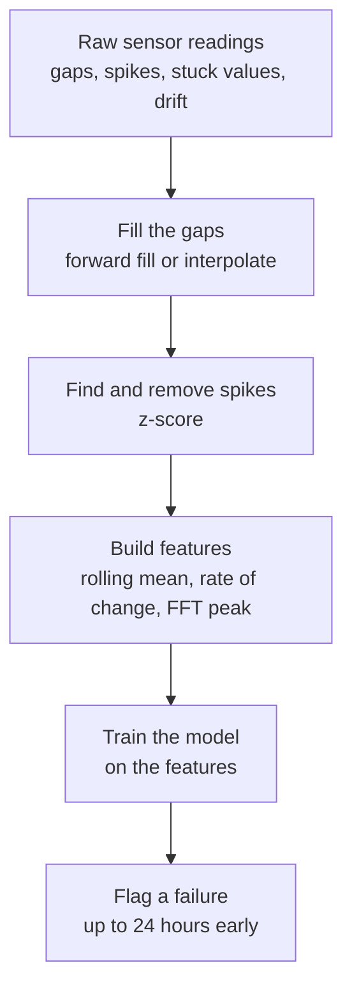

import TawkWidget from '../../../../components/TawkWidget.astro';
import UniversalContentContributors from '../../../../components/UniversalContentContributors.astro';
import InArticleAd from '../../../../components/InArticleAd.astro';
import Copyright from '../../../../components/Copyright.astro';
import BionicText from '../../../../components/BionicText.astro';
import TailwindWrapper from '../../../../components/TailwindWrapper.jsx';
import { Tabs, TabItem } from '@astrojs/starlight/components';
import { Card, CardGrid, Badge, Steps, LinkButton, FileTree } from '@astrojs/starlight/components';

<UniversalContentContributors 
  contributors={frontmatter.contributors}
/>


import MlAiFundamentalsComments from '../../../../components/ml-ai-fundamentals/MlAiFundamentalsComments.astro';

A model that scored 97% on a tidy practice file can fail in its first week on a real pump. The cause is seldom the model. It is the readings: a sensor silent for three hours, one reading of 87 where 1.4 was expected, a probe that reads higher every month. This lesson shows what each fault does to a model. Then you clean the readings and train a model that flags a failing pump a day ahead. #SensorData #FeatureEngineering #PredictiveMaintenance

## The Problem with Raw Sensor Data

A file from a real machine looks like this:

```text
  ┌────────┬────────┬────────┐
  │  temp  │  vib   │ press  │
  │  22.1  │  NaN   │  45.2  │  gap: no reading arrived
  │  22.3  │  1.4   │  45.1  │
  │  22.2  │  87.6  │  45.3  │  spike: one impossible value
  │  23.1  │  1.5   │  45.3  │
  │  24.8  │  1.6   │  45.3  │  stuck: pressure repeats 45.3
  │  26.5  │  1.7   │  45.3  │  drift: temp climbs slowly
  └────────┴────────┴────────┘
```

Each of the four faults harms a model in its own way:

- **A gap.** The sensor or the link stopped, and the file holds `NaN` ("not a number"). Most models refuse a row with a missing value. If you delete the rows, "the last 6 readings" no longer means the last 6 hours.
- **A spike.** One reading lies far from its neighbours, from electrical noise or a communication error. One spike of 12 g among readings of 2 g lifts a 6 hour average to (12 + 5 × 2) / 6 = 3.7 g, which is what a failing bearing looks like.
- **A stuck value.** The sensor repeats one number. The signal looks calm, so the model answers "healthy" while the machine may be changing.
- **Drift.** The sensor slowly reads higher although the machine has not changed. Here the temperature sensor gains 0.002 °C every hour after hour 3000, which is 4 °C by the end. To a model, that is a machine getting hotter.

Vibration is in g: 1 g is 9.81 m/s².


<Card title="A trend says more than one reading" icon="star">
"The vibration is 4.2 g" tells you less than "the vibration has risen 30% in a week". A model sees one row at a time, so the past must be put into the row. Calculating such inputs, called **features**, is **feature engineering**.
</Card>

## Generate Realistic Pump Sensor Data

<InArticleAd />


The program makes hourly practice readings from a pump with four sensors, with gaps, spikes, drift and 50 failures. Before each failure the vibration and the temperature rise for 24 to 48 hours. Each of the last 24 hours before a failure has the label 1.

```python
import numpy as np
import pandas as pd

np.random.seed(42)

n_samples = 5000
hours = np.arange(n_samples)  # one reading per hour, ~208 days

# Base signals with daily and weekly cycles
daily_cycle = np.sin(2 * np.pi * hours / 24)
weekly_cycle = np.sin(2 * np.pi * hours / (24 * 7))

# Vibration (g): normal range 1.0-3.0
vibration = 2.0 + 0.3 * daily_cycle + np.random.normal(0, 0.2, n_samples)

# Temperature (C): normal range 40-60
temperature = 50 + 5 * daily_cycle + 2 * weekly_cycle + np.random.normal(0, 1.5, n_samples)

# Pressure (bar): normal range 4.0-6.0
pressure = 5.0 + 0.5 * daily_cycle + np.random.normal(0, 0.15, n_samples)

# Flow rate (L/min): normal range 80-120
flow_rate = 100 + 10 * daily_cycle + np.random.normal(0, 3, n_samples)

# Add calibration drift to temperature sensor (starts at hour 3000)
drift_mask = hours > 3000
drift_amount = (hours[drift_mask] - 3000) * 0.002  # slow upward drift
temperature[drift_mask] += drift_amount

# Add outlier spikes (0.5% of readings)
n_outliers = int(0.005 * n_samples)
outlier_indices = np.random.choice(n_samples, n_outliers, replace=False)
vibration[outlier_indices[:n_outliers//2]] += np.random.uniform(5, 15, n_outliers//2)
pressure[outlier_indices[n_outliers//2:]] += np.random.uniform(3, 8, n_outliers - n_outliers//2)

# Add missing values (2% sensor dropouts)
n_missing = int(0.02 * n_samples)
vib_missing = np.random.choice(n_samples, n_missing, replace=False)
temp_missing = np.random.choice(n_samples, n_missing, replace=False)
press_missing = np.random.choice(n_samples, n_missing // 2, replace=False)

vibration_raw = vibration.copy()
temperature_raw = temperature.copy()
pressure_raw = pressure.copy()

vibration_raw[vib_missing] = np.nan
temperature_raw[temp_missing] = np.nan
pressure_raw[press_missing] = np.nan

# Generate failure events (50 failures spread across the dataset)
failure_label = np.zeros(n_samples, dtype=int)
failure_starts = np.sort(np.random.choice(
    range(200, n_samples - 50), 50, replace=False
))

# Before each failure, sensors show degradation for 24-48 hours
for start in failure_starts:
    pre_failure_hours = np.random.randint(24, 48)
    ramp_start = max(0, start - pre_failure_hours)

    # Vibration increases before failure
    ramp = np.linspace(0, 2.5, start - ramp_start)
    vibration_raw[ramp_start:start] += ramp
    temperature_raw[ramp_start:start] += ramp * 0.8

    # Mark the 24 hours before failure as "failure imminent"
    label_start = max(0, start - 24)
    failure_label[label_start:start + 1] = 1

# Build DataFrame
timestamps = pd.date_range('2025-09-01', periods=n_samples, freq='h')
df = pd.DataFrame({
    'timestamp': timestamps,
    'vibration': np.round(vibration_raw, 3),
    'temperature': np.round(temperature_raw, 2),
    'pressure': np.round(pressure_raw, 3),
    'flow_rate': np.round(flow_rate, 2),
    'failure_within_24h': failure_label
})

print("Dataset shape:", df.shape)
print(f"Time range: {df['timestamp'].min()} to {df['timestamp'].max()}")
print(f"\nMissing values:")
print(df.isnull().sum().to_string())
print(f"\nFailure events: {failure_label.sum()} hours labeled as failure-imminent")
print(f"Normal:  {(failure_label == 0).sum()} ({(failure_label == 0).mean():.1%})")
print(f"Failure: {(failure_label == 1).sum()} ({(failure_label == 1).mean():.1%})")
print(f"\nFirst 10 rows:")
print(df.head(10).to_string(index=False))
print(f"\nSummary statistics:")
print(df.describe().round(3).to_string())
```

**Expected output (approximate):**

```text
Dataset shape: (5000, 6)
Time range: 2025-09-01 00:00:00 to 2026-03-28 07:00:00

Missing values:
timestamp               0
vibration             100
temperature           100
pressure               50
flow_rate               0
failure_within_24h      0

Failure events: 1071 hours labeled as failure-imminent
Normal:  3929 (78.6%)
Failure: 1071 (21.4%)

First 10 rows:
          timestamp  vibration  temperature  pressure  flow_rate  failure_within_24h
2025-09-01 00:00:00      2.099        49.36     4.898      99.57                   0
...
```

## Handling Missing Values

<InArticleAd />


There are three ways to treat a gap:

- **Drop the row.** Good when gaps are few (under about 1%).
- **Forward fill.** Repeat the last known value. Good for a quantity that holds its value, such as a setpoint.
- **Interpolate.** Draw a straight line across the gap. Good for a quantity that changes smoothly, such as temperature.

A filled value is a guess. Fill short gaps only.

```python
import numpy as np
import pandas as pd

np.random.seed(42)

# (Regenerate the dataset from above, or assume df is loaded)
# For brevity, we create a small example showing each strategy:

# Create a sample time series with gaps
sample_times = pd.date_range('2025-09-01', periods=20, freq='h')
sample_vib = [2.1, 2.0, np.nan, np.nan, 2.2, 2.1, 2.3, np.nan, 2.4, 2.5,
              2.3, 2.2, np.nan, 2.1, 2.0, 2.2, np.nan, np.nan, 2.3, 2.1]
sample_df = pd.DataFrame({
    'timestamp': sample_times,
    'vibration': sample_vib
})

print("Original data (NaN = missing):")
print(sample_df['vibration'].values)

# Strategy 1: Drop rows with missing values
dropped = sample_df.dropna()
print(f"\nDrop NaN: {len(dropped)} rows remain (lost {len(sample_df) - len(dropped)} rows)")

# Strategy 2: Forward fill (carry last known value)
ffilled = sample_df['vibration'].ffill()
print(f"Forward fill:  {ffilled.values}")

# Strategy 3: Linear interpolation
interpolated = sample_df['vibration'].interpolate(method='linear')
print(f"Interpolated:  {np.round(interpolated.values, 3)}")

print("\n--- When to Use Each Strategy ---")
print("Drop:         When missing data is rare and random (< 1%)")
print("Forward fill: When the sensor holds its last value (e.g., digital sensors)")
print("Interpolate:  When the signal changes smoothly (temperature, pressure)")
```

**Expected output:**

```text
Original data (NaN = missing):
[2.1 2.  nan nan 2.2 2.1 2.3 nan 2.4 2.5 2.3 2.2 nan 2.1 2.  2.2 nan nan
 2.3 2.1]

Drop NaN: 14 rows remain (lost 6 rows)
Forward fill:  [2.1 2.  2.  2.  2.2 2.1 2.3 2.3 2.4 2.5 2.3 2.2 2.2 2.1 2.  2.2 2.2 2.2
 2.3 2.1]
Interpolated:  [2.1   2.    2.067 2.133 2.2   2.1   2.3   2.35  2.4   2.5   2.3   2.2
 2.15  2.1   2.    2.2   2.233 2.267 2.3   2.1  ]
```

## Detecting and Removing Outliers

<InArticleAd />


To find spikes, the program uses the **z-score**: the distance of a reading from the mean, counted in standard deviations (the usual distance of the readings from their mean). A z-score above 3 is rare for a real reading, so the program replaces such readings with `NaN` and interpolates over them.

```python
import numpy as np
import pandas as pd

np.random.seed(42)

# Simulate vibration with outliers
n = 500
vibration = 2.0 + np.random.normal(0, 0.2, n)
# Inject 5 outlier spikes
outlier_idx = [50, 150, 250, 350, 450]
vibration[outlier_idx] += np.array([8.0, 12.0, 6.0, 10.0, 9.0])

# Z-score based outlier detection
mean_vib = np.nanmean(vibration)
std_vib = np.nanstd(vibration)
z_scores = np.abs((vibration - mean_vib) / std_vib)

threshold = 3.0  # values beyond 3 standard deviations
outliers_found = np.where(z_scores > threshold)[0]

print(f"Mean: {mean_vib:.3f}, Std: {std_vib:.3f}")
print(f"Outliers found at indices: {outliers_found}")
print(f"Outlier values: {vibration[outliers_found].round(3)}")

# Replace outliers with NaN, then interpolate
vibration_clean = vibration.copy()
vibration_clean[z_scores > threshold] = np.nan
vibration_clean = pd.Series(vibration_clean).interpolate().values

print(f"\nBefore cleaning: min={vibration.min():.2f}, max={vibration.max():.2f}")
print(f"After cleaning:  min={vibration_clean.min():.2f}, max={vibration_clean.max():.2f}")
```

**Expected output (approximate):**

```text
Mean: 2.091, Std: 0.938
Outliers found at indices: [ 50 150 250 350 450]
Outlier values: [10.065 14.05   7.748 12.062 10.987]

Before cleaning: min=1.35, max=14.05
After cleaning:  min=1.35, max=2.77
```

Two cautions about this filter:

- **The spikes spoil the measure that finds them.** The five spikes raise the standard deviation from 0.2 g to 0.938 g, so the limit sits at 2.091 + 3 × 0.938 = 4.9 g.
- **A fault is not a spike.** A spike is one reading. A failing bearing gives many high readings in a row. Remove only what you can explain as a sensor fault.

A z-score does not find a stuck value. Look for the same number many times in a row.

## Feature Engineering

<InArticleAd />


The program adds five kinds of feature, which tell the model what happened before each reading:

1. **Rolling statistics.** The mean and the standard deviation of the last 6, 24 or 168 hours.
2. **Rate of change.** The reading minus the reading 1 hour or 24 hours earlier.
3. **Ratios.** The 6 hour mean divided by the 168 hour mean. Above 1, the recent hours are higher than the week.
4. **Time.** The hour of the day and the day of the week.
5. **FFT peak.** The fast Fourier transform (FFT) finds the strongest repeating rhythm in the last 24 hours.

```python
import numpy as np
import pandas as pd

np.random.seed(42)

# Generate 5000 hours of pump data (simplified, clean version for feature engineering)
n_samples = 5000
hours = np.arange(n_samples)
daily_cycle = np.sin(2 * np.pi * hours / 24)

vibration = 2.0 + 0.3 * daily_cycle + np.random.normal(0, 0.2, n_samples)
temperature = 50 + 5 * daily_cycle + np.random.normal(0, 1.5, n_samples)
pressure = 5.0 + 0.5 * daily_cycle + np.random.normal(0, 0.15, n_samples)
flow_rate = 100 + 10 * daily_cycle + np.random.normal(0, 3, n_samples)

# Add pre-failure degradation for 50 events
failure_label = np.zeros(n_samples, dtype=int)
failure_starts = np.sort(np.random.choice(range(200, n_samples - 50), 50, replace=False))
for start in failure_starts:
    pre_hours = np.random.randint(24, 48)
    ramp_start = max(0, start - pre_hours)
    ramp = np.linspace(0, 2.5, start - ramp_start)
    vibration[ramp_start:start] += ramp
    temperature[ramp_start:start] += ramp * 0.8
    label_start = max(0, start - 24)
    failure_label[label_start:start + 1] = 1

timestamps = pd.date_range('2025-09-01', periods=n_samples, freq='h')
df = pd.DataFrame({
    'timestamp': timestamps,
    'vibration': vibration,
    'temperature': temperature,
    'pressure': pressure,
    'flow_rate': flow_rate,
    'failure_within_24h': failure_label,
})

# ---- Feature Engineering ----

# 1. Rolling statistics (windows of 6h, 24h, 168h)
for col in ['vibration', 'temperature', 'pressure', 'flow_rate']:
    df[f'{col}_roll6_mean'] = df[col].rolling(6, min_periods=1).mean()
    df[f'{col}_roll24_mean'] = df[col].rolling(24, min_periods=1).mean()
    df[f'{col}_roll24_std'] = df[col].rolling(24, min_periods=1).std()
    df[f'{col}_roll168_mean'] = df[col].rolling(168, min_periods=1).mean()

# 2. Rate of change (derivative: current value minus value 1 hour ago)
for col in ['vibration', 'temperature', 'pressure', 'flow_rate']:
    df[f'{col}_delta1h'] = df[col].diff(1)
    df[f'{col}_delta24h'] = df[col].diff(24)

# 3. Ratio features (short-term average / long-term average)
for col in ['vibration', 'temperature']:
    df[f'{col}_ratio_6_168'] = df[f'{col}_roll6_mean'] / df[f'{col}_roll168_mean']

# 4. Hour of day and day of week
df['hour'] = df['timestamp'].dt.hour
df['day_of_week'] = df['timestamp'].dt.dayofweek

# 5. FFT peak frequency (computed on rolling 24-hour windows).
# This dataset is sampled once per hour, so sample_rate=1 means "1 sample/hour"
# and the returned frequencies are in cycles-per-hour. For real vibration
# monitoring you would sample at kHz to catch bearing-fault frequencies in Hz.
def fft_peak_freq(window, sample_rate=1.0):
    """Return the frequency with the highest magnitude (excluding DC)."""
    if len(window) < 4:
        return 0.0
    fft_vals = np.fft.rfft(window - window.mean())
    freqs = np.fft.rfftfreq(len(window), d=1.0/sample_rate)
    magnitudes = np.abs(fft_vals[1:])  # skip DC component
    if len(magnitudes) == 0:
        return 0.0
    return freqs[1:][np.argmax(magnitudes)]

# Apply FFT on vibration in rolling windows (each window is the last 24 hours)
fft_peaks = []
for i in range(n_samples):
    start_idx = max(0, i - 23)
    window = vibration[start_idx:i+1]
    fft_peaks.append(fft_peak_freq(window))
df['vibration_fft_peak'] = fft_peaks

# Drop NaN rows from rolling/diff operations
df_features = df.dropna().copy()

print(f"Original columns: 6")
print(f"After feature engineering: {len(df_features.columns)} columns")
print(f"Samples after dropping NaN: {len(df_features)}")
print(f"\nEngineered feature names:")
feature_cols = [c for c in df_features.columns
                if c not in ['timestamp', 'failure_within_24h',
                             'vibration', 'temperature', 'pressure', 'flow_rate']]
for col in feature_cols:
    print(f"  {col}")

print(f"\nSample of engineered features (row 500):")
row = df_features.iloc[500]
print(f"  vibration (raw):           {row['vibration']:.3f}")
print(f"  vibration_roll6_mean:      {row['vibration_roll6_mean']:.3f}")
print(f"  vibration_roll24_mean:     {row['vibration_roll24_mean']:.3f}")
print(f"  vibration_roll24_std:      {row['vibration_roll24_std']:.3f}")
print(f"  vibration_delta1h:         {row['vibration_delta1h']:.3f}")
print(f"  vibration_ratio_6_168:     {row['vibration_ratio_6_168']:.3f}")
print(f"  vibration_fft_peak:        {row['vibration_fft_peak']:.4f}")
```

**Expected output (approximate):**

```text
Original columns: 6
After feature engineering: 35 columns
Samples after dropping NaN: 4976

Engineered feature names:
  vibration_roll6_mean
  vibration_roll24_mean
  vibration_roll24_std
  vibration_roll168_mean
  temperature_roll6_mean
  ...
  vibration_ratio_6_168
  temperature_ratio_6_168
  hour
  day_of_week
  vibration_fft_peak

Sample of engineered features (row 500):
  vibration (raw):           3.088
  vibration_roll6_mean:      3.012
  vibration_roll24_mean:     2.649
  vibration_roll24_std:      0.440
  vibration_delta1h:         -0.165
  vibration_ratio_6_168:     1.266
  vibration_fft_peak:        0.0417
```

In row 500 the 6 hour mean (3.012 g) is above the 24 hour mean (2.649 g), and the ratio to the weekly mean is 1.266: the vibration is rising.

## Train a Predictive Maintenance Model

<InArticleAd />


A model is judged only on readings it has not seen: it is fitted to a training set, and a test set is kept back to score it.

<Card title="Never split a time series at random" icon="warning">
The program takes the first 80% of the hours for training and the last 20% for testing, not rows picked at random.

With a random division, the hours on each side of a test hour are in the training set. The 6 hour means at 14:00 and at 15:00 share five of their six readings, so the model has almost seen each test row: the score looks excellent and the model fails on the machine.

For cross-validation use `TimeSeriesSplit`, described in [Practical ML with Scikit-Learn](/education/ml-ai-fundamentals/practical-ml-scikit-learn/).
</Card>

To stay short, the program makes the readings again without gaps and spikes. On real readings you clean first.

```python
import numpy as np
import pandas as pd
from sklearn.model_selection import train_test_split
from sklearn.preprocessing import StandardScaler
from sklearn.ensemble import RandomForestClassifier
from sklearn.metrics import classification_report, confusion_matrix

np.random.seed(42)

# Regenerate full dataset with features (condensed)
n_samples = 5000
hours = np.arange(n_samples)
daily_cycle = np.sin(2 * np.pi * hours / 24)

vibration = 2.0 + 0.3 * daily_cycle + np.random.normal(0, 0.2, n_samples)
temperature = 50 + 5 * daily_cycle + np.random.normal(0, 1.5, n_samples)
pressure = 5.0 + 0.5 * daily_cycle + np.random.normal(0, 0.15, n_samples)
flow_rate = 100 + 10 * daily_cycle + np.random.normal(0, 3, n_samples)

failure_label = np.zeros(n_samples, dtype=int)
failure_starts = np.sort(np.random.choice(range(200, n_samples - 50), 50, replace=False))
for start in failure_starts:
    pre_hours = np.random.randint(24, 48)
    ramp_start = max(0, start - pre_hours)
    ramp = np.linspace(0, 2.5, start - ramp_start)
    vibration[ramp_start:start] += ramp
    temperature[ramp_start:start] += ramp * 0.8
    label_start = max(0, start - 24)
    failure_label[label_start:start + 1] = 1

timestamps = pd.date_range('2025-09-01', periods=n_samples, freq='h')
df = pd.DataFrame({
    'timestamp': timestamps,
    'vibration': vibration, 'temperature': temperature,
    'pressure': pressure, 'flow_rate': flow_rate,
    'failure_within_24h': failure_label,
})

# Feature engineering
for col in ['vibration', 'temperature', 'pressure', 'flow_rate']:
    df[f'{col}_roll6_mean'] = df[col].rolling(6, min_periods=1).mean()
    df[f'{col}_roll24_mean'] = df[col].rolling(24, min_periods=1).mean()
    df[f'{col}_roll24_std'] = df[col].rolling(24, min_periods=1).std()
    df[f'{col}_delta1h'] = df[col].diff(1)
    df[f'{col}_delta24h'] = df[col].diff(24)

for col in ['vibration', 'temperature']:
    roll168 = df[col].rolling(168, min_periods=1).mean()
    df[f'{col}_ratio_6_168'] = df[f'{col}_roll6_mean'] / roll168

df['hour'] = df['timestamp'].dt.hour
df['day_of_week'] = df['timestamp'].dt.dayofweek
df = df.dropna()

# Select features (exclude raw sensor values and timestamp)
feature_cols = [c for c in df.columns
                if c not in ['timestamp', 'failure_within_24h',
                             'vibration', 'temperature', 'pressure', 'flow_rate']]
X = df[feature_cols].values
y = df['failure_within_24h'].values

print(f"Features: {len(feature_cols)}")
print(f"Samples: {len(X)}")
print(f"Class balance: Normal={np.sum(y==0)}, Failure={np.sum(y==1)}")

# Train/test split (time-based: first 80% for training, last 20% for testing)
split_idx = int(0.8 * len(X))
X_train, X_test = X[:split_idx], X[split_idx:]
y_train, y_test = y[:split_idx], y[split_idx:]

# Scale features
scaler = StandardScaler()
X_train_scaled = scaler.fit_transform(X_train)
X_test_scaled = scaler.transform(X_test)

# Train Random Forest
rf = RandomForestClassifier(
    n_estimators=200,
    max_depth=15,
    class_weight='balanced',  # handle class imbalance
    random_state=42,
    n_jobs=-1
)
rf.fit(X_train_scaled, y_train)

# Evaluate
y_pred = rf.predict(X_test_scaled)

print("\n" + "=" * 50)
print("PREDICTIVE MAINTENANCE RESULTS")
print("=" * 50)
print("\nClassification Report:")
print(classification_report(y_test, y_pred, target_names=['Normal', 'Failure']))

cm = confusion_matrix(y_test, y_pred)
print("Confusion Matrix:")
print(f"                 Predicted Normal  Predicted Failure")
print(f"  Actual Normal:    {cm[0][0]:5d}            {cm[0][1]:5d}")
print(f"  Actual Failure:   {cm[1][0]:5d}            {cm[1][1]:5d}")

# Feature importance
importances = rf.feature_importances_
importance_sorted = sorted(zip(feature_cols, importances),
                          key=lambda x: x[1], reverse=True)

print("\nTop 10 Most Important Features:")
for name, imp in importance_sorted[:10]:
    bar = "#" * int(imp * 200)
    print(f"  {name:30s} {imp:.4f} {bar}")
```

**Expected output (approximate):**

```text
Features: 24
Samples: 4976
Class balance: Normal=3857, Failure=1119

==================================================
PREDICTIVE MAINTENANCE RESULTS
==================================================

Classification Report:
              precision    recall  f1-score   support

      Normal       0.99      0.97      0.98       817
     Failure       0.88      0.96      0.92       179

    accuracy                           0.97       996
   macro avg       0.94      0.96      0.95       996
weighted avg       0.97      0.97      0.97       996

Confusion Matrix:
                 Predicted Normal  Predicted Failure
  Actual Normal:      794               23
  Actual Failure:       8              171

Top 10 Most Important Features:
  vibration_roll6_mean           0.2378 ###############################################
  vibration_ratio_6_168          0.1737 ##################################
  vibration_roll24_mean          0.1402 ############################
  vibration_delta24h             0.1363 ###########################
  vibration_roll24_std           0.0996 ###################
  temperature_roll24_mean        0.0469 #########
  ...
```

The 6 hour mean of vibration is the most important feature, as expected: the vibration rises before a failure, and a short mean shows that rise without the noise of single hours.

## Interpreting the Results

<InArticleAd />


The accuracy of 0.97 says little, because most hours are normal: a model that never flags anything is right for 817 of the 996 test hours, or 82%. Read the two kinds of mistake: 8 missed hours and 23 false alarms.

<CardGrid>
<Card title="Precision (Failure)" icon="star">
Of the 194 hours the model flagged, 171 were really within 24 hours of a failure: 88%. The other 23 were false alarms. A false alarm costs an inspection.
</Card>
<Card title="Recall (Failure)" icon="star">
Of the 179 hours that really were within 24 hours of a failure, the model flagged 171: 96%. It missed 8. Where a missed failure is costly, watch recall.
</Card>
</CardGrid>

The flag is advice for the person who plans maintenance, and it is sometimes wrong. The limit that stops the pump at once on high temperature stays a plain fixed rule in the pump controller.

:::tip[Instrument it]
Much "bad data" starts before the data file: a sensor mounted differently, a loose cable. Cleaning cannot fully repair it. Mount the [sensor the same way each time](/education/sensor-actuator-interfacing-stm32/) and record over the full range of real conditions. A model trained on readings that match the field is one you can [deploy](/education/iot-systems/) and check as it [reports live](https://siliconwit.io).
:::

## Key Takeaways

<InArticleAd />


<Steps>

1. **Clean before you train**: gaps, spikes, stuck values and drift are normal. Remove only what you can explain as a sensor fault.

2. **Put the past into each row**: rolling means, rates of change and ratios show a trend that one reading hides.

3. **Divide a time series by time**: the earliest readings for training, the latest for testing.

4. **Failures are rare, so accuracy says little**: count missed failures and false alarms. `class_weight='balanced'` makes each failure row count for more in training.

5. **Check feature importance against what you know**: if the top features make no physical sense, look for a mistake in the preparation.

</Steps>
<MlAiFundamentalsComments />


<InArticleAd />
<TawkWidget />
<Copyright />
